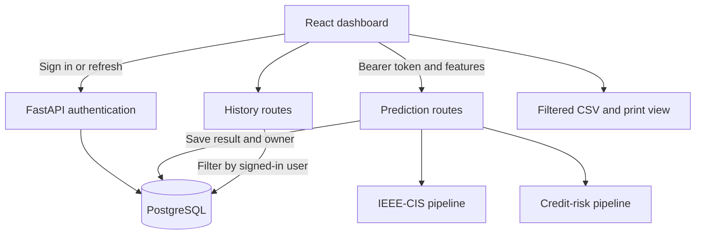
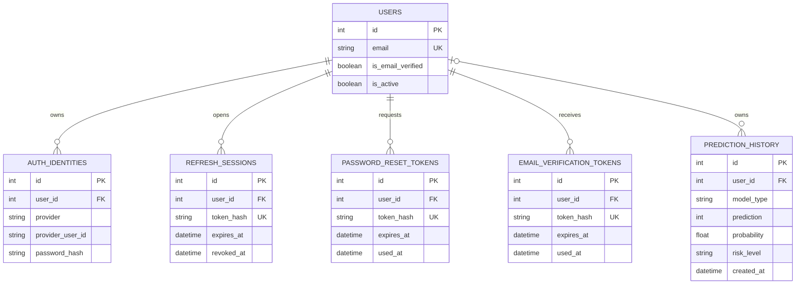

# FraudShield

FraudShield is a React and FastAPI prototype for two binary classification tasks. The fraud model scores IEEE-CIS transaction records. The credit-risk model estimates serious delinquency within two years using Give Me Some Credit borrower attributes. Each authenticated prediction creates a history record for its owner. Dashboard counts, report filters and exports use those records.

## Local setup on Windows

Use PowerShell, Python 3.13, Node.js 24 with npm, and a running PostgreSQL instance. The API loads the shipped scikit-learn pipelines. Raw training data is required for reproducing the experiments.

From the repository root:

```powershell
python -m venv .venv
.\.venv\Scripts\python -m pip install -r Backend/requirements.txt
Copy-Item Backend/.env.example Backend/.env
Copy-Item Frontend/.env.example Frontend/.env
```

Copy the templates on a fresh installation. On an existing installation, merge missing keys into the existing environment files. Create a local PostgreSQL database and a role that can create and alter its tables. Enter its SQLAlchemy connection URL and a newly generated JWT signing secret in the backend environment. Configure the same Google web client ID on both sides for Google sign-in. The Google client should allow the frontend origin. Email verification and password recovery use the configured Gmail SMTP account and app password. The frontend environment is public build-time configuration.

Start the API from the repository root:

```powershell
cd Backend
..\.venv\Scripts\python -m alembic upgrade head
..\.venv\Scripts\python -m alembic current
..\.venv\Scripts\python -m uvicorn app.main:app --host 127.0.0.1 --port 8000
```

In another terminal:

```powershell
cd Frontend
npm ci
npm run dev -- --host localhost --port 5173 --strictPort
```

Open [the dashboard](http://localhost:5173) and sign in with a verified account. The API's [interactive documentation](http://localhost:8000/docs) lists all authentication, schema, prediction and history operations. The [health endpoint](http://localhost:8000/health) reports availability for each model. Keep the frontend origin, API URL, backend CORS allowlist and email link origin consistent. HTTPS deployments need the secure refresh-cookie setting.

## Architecture



The browser holds the access token in application state. Session restoration uses an HTTP-only refresh cookie. The two pipelines run inside the FastAPI process. Their fitted preprocessing and classifiers are loaded at startup. Reports and analytics aggregate the authenticated user's history. User-uploaded profile images use the backend uploads directory.

## Database schema



The diagram lists the fields relevant to authentication and scoring. Prediction ownership is nullable for legacy or detached rows. New writes use the authenticated user's ID. Unowned rows are excluded from personal history.

## Prediction and history API

| Method and route | Input | Output |
|---|---|---|
| POST /auth/login | Verified account email and password | Access token, user information, refresh cookie |
| POST /auth/google | Google ID credential | Existing linked account session |
| POST /auth/refresh or /auth/logout | Refresh cookie | Renew access or revoke refresh session |
| GET /predict/fraud/schema | Bearer token | 431 feature names |
| GET /predict/credit-risk/schema | Bearer token | 10 feature names |
| POST /predict/fraud | Bearer token and complete features object | Transaction fraud prediction, score, risk band and history ID |
| POST /predict/credit-risk | Bearer token and complete features object | Serious delinquency prediction, score, risk band and history ID |
| GET /history | Bearer token, optional limit, offset and model_type | Total, pagination fields and owned records in reverse time order |
| GET /history/{history_id} | Bearer token | Owner's record, or 404 |

Use numeric JSON values for numeric features, categorical values appropriate to the training schema, and JSON null for missing observations. Use fraud or credit_risk as the history model_type. The result's probability is a score for class 1. Positive classification uses the model-specific decision threshold. Risk bands are additional application labels.

Full request bodies are checked in for both models. [Fraud sample](Backend/fraud_test_payload.json) · [Credit sample](Backend/credit_risk_test_payload.json)

From the repository root, with an access token from a dedicated test account in the session environment:

```powershell
$headers = @{ Authorization = "Bearer $env:FRAUDSHIELD_ACCESS_TOKEN" }
$api = "http://localhost:8000"
Invoke-RestMethod "$api/predict/fraud" -Method Post -Headers $headers -ContentType "application/json" -InFile Backend/fraud_test_payload.json
Invoke-RestMethod "$api/predict/credit-risk" -Method Post -Headers $headers -ContentType "application/json" -InFile Backend/credit_risk_test_payload.json
Invoke-RestMethod "$api/history?model_type=credit_risk&limit=10" -Headers $headers
```

Invalid or expired authentication returns 401. Schema or feature validation errors return 422. An unavailable model returns 503. The history-list limit is 1 through 100. CSV export uses the report's model filter. Print / Save PDF uses the browser print dialog.

## Experiments and test reproduction

The experiments use seed 42, chronological 70/15/15 partitions for IEEE-CIS and stratified 70/15/15 partitions for credit. Both compare weighted and unweighted Random Forests against a training-prior baseline. Model and threshold selection use validation F1. The evaluation report includes final holdout tables, confusion counts, threshold analysis, class distributions, precision-recall and ROC curves, feature rankings and reproduction commands. [Evaluation report](Backend/reports/research/Evaluation.md)

The fraud experiment expects the matching labeled parquet partitions under Backend/data/processed. For a fresh preparation, supply the labeled train_transaction.csv and train_identity.csv in the dataset directory configured in training/prepare_fraud_dataset.py, then run that script followed by training/create_temporal_splits.py. The credit experiment accepts the labeled cs-training.csv using --credit-csv. Use a different --output directory for an independent reproduction so the archived tables remain available for comparison.

```powershell
cd Backend
..\.venv\Scripts\python -m pytest -q
..\.venv\Scripts\python training/demo_workflow.py
cd ../Frontend
node --test tests/reports.test.js
npm run build
```

The API workflow demo logs in a temporary synthetic account, scores the two example records and checks the history IDs using an isolated database. Operational database and browser checks have their own evidence in the [final audit](Backend/reports/research/Final-audit.md).

## Limitations and future work

- The fraud holdout covers a later period of the same dataset. Credit results use a random split of one labeled dataset. Both models miss a substantial fraction of positive cases.
- Model scores and pipeline impurity rankings describe dataset performance. Probability calibration, external validation, subgroup evaluation and per-case explanations are open research questions.
- The 431-field fraud form accepts a complete JSON record. Reports contain scores, risk and timestamps. Monetary analytics would require additional persisted transaction attributes.
- Real Google consent, email delivery, browser print behavior and a migrated PostgreSQL installation require environment-specific checks. See the audit for the checks observed on this revision.
