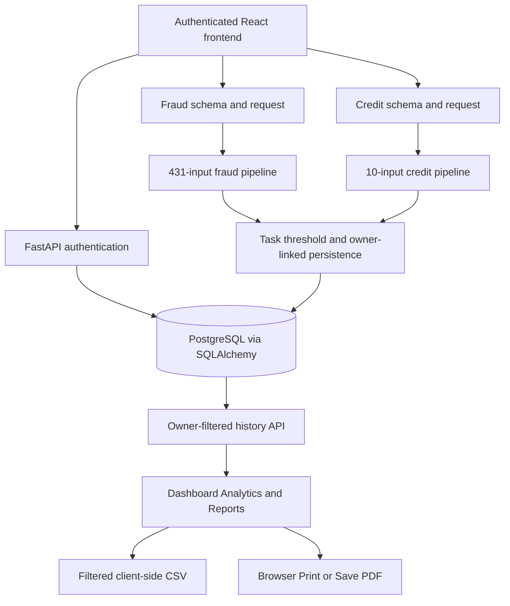
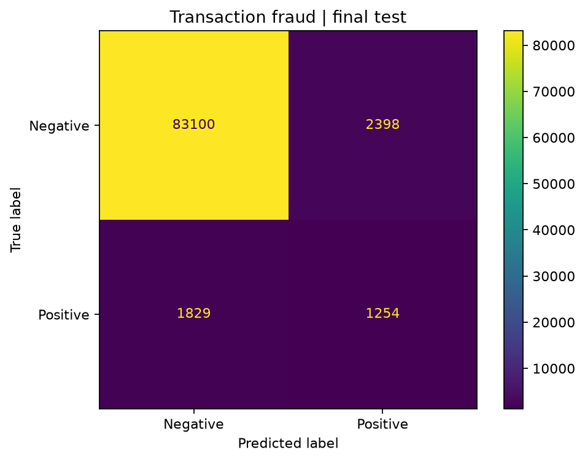
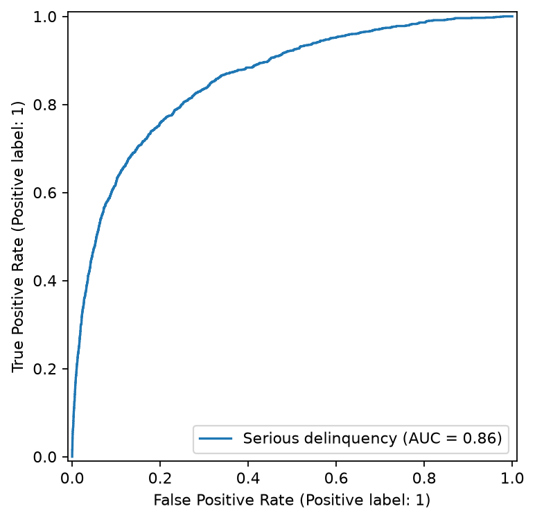
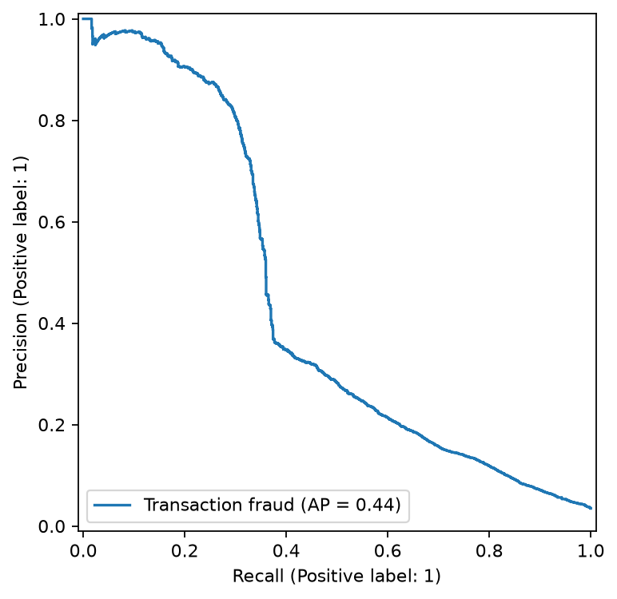
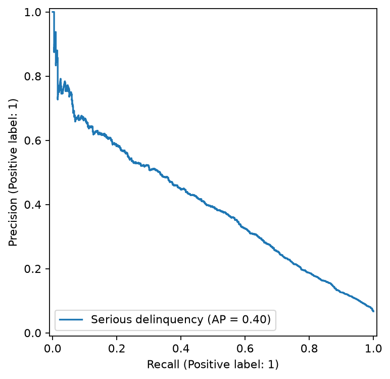
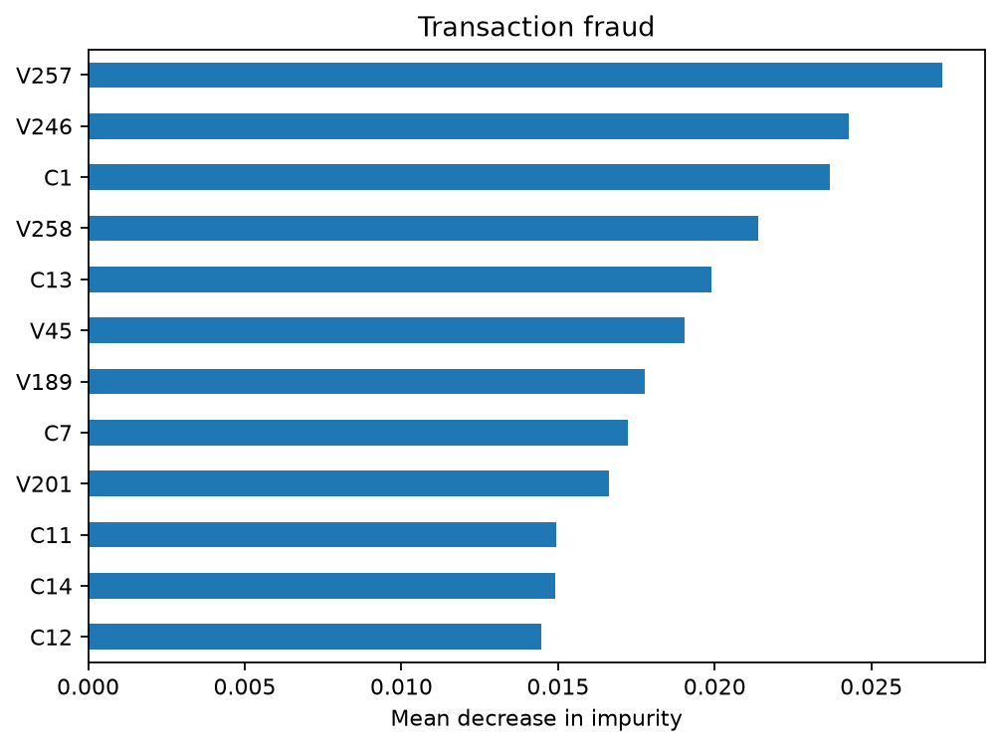
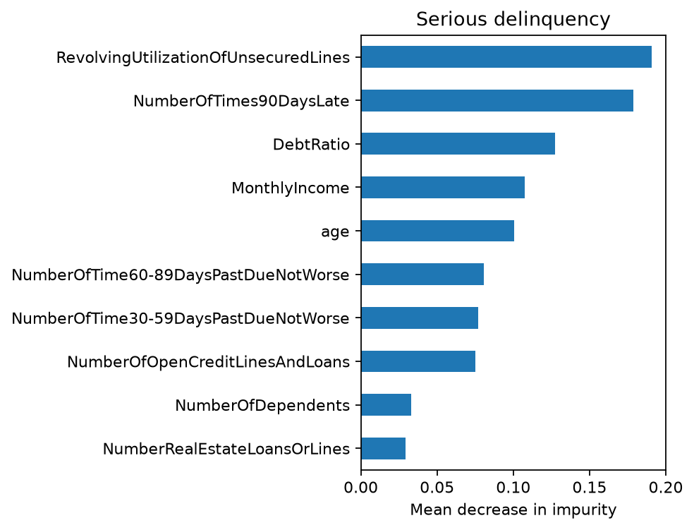

# FraudShield: Validation-Selected Random Forest Pipelines for Transaction Fraud Detection and Credit Delinquency Assessment

**Manuscript V2 — content draft, 18 November 2026.** Authorship, affiliations, funding declarations and target venue have not been supplied and are not invented. This manuscript reports preserved experiments and inspected implementation, with previously documented verification identified separately. No training, inference experiment or live application demonstration was performed for V2. Evidence identifiers E01–E22 resolve in `v2-evidence-crosswalk.md`; numeric citations resolve in References. The companion validation report states the checks and remaining limits of this draft.

## Abstract

Financial fraud detection and borrower delinquency assessment involve different targets but share the need for careful evaluation under class imbalance. FraudShield integrates two independent Random Forest pipelines within an authenticated application. This study reports preserved experiments comparing weighted and unweighted forests with a constant-prior baseline. IEEE-CIS uses chronological 70/15/15 partitions, while Give Me Some Credit uses stratified random partitions in the same proportions. Forests and decision thresholds are selected using validation F1. The selected unweighted models use 431 and 10 inputs, with thresholds of 0.21 and 0.23. Saved holdout results give fraud precision 0.343373, recall 0.406747 and F1 0.372383 on 88,581 transactions; credit precision is 0.407090, recall 0.473404 and F1 0.437750 on 22,500 borrowers. The unweighted fraud forest wins validation F1, but its weighted comparator achieves higher holdout F1, 0.444087. This reversal is retained rather than used for retrospective model selection. Artifact inspection supports common fitted preprocessing, although exact historical training-row identity for the reused weighted fraud model remains unproven. Trapezoidal precision–recall area and Average Precision are reported separately. The application implements inference, owned history and reporting, but genuine live demonstration remains pending. The evidence supports a bounded empirical and implementation study, not a solution to imbalance, calibrated financial risk, a fused predictor or drift adaptation.

**Index Terms—** Transaction fraud detection, credit delinquency, random forests, imbalanced classification, threshold selection, artifact provenance.

## I. Introduction and Research Problem

Financial applications may present transaction monitoring and borrower assessment within one interface, but integration does not make their prediction targets equivalent. A transaction-fraud label concerns a transaction, whereas the Give Me Some Credit target concerns a borrower outcome. FraudShield therefore uses separate feature schemas, fitted preprocessors, classifiers and decision thresholds. The system shares authentication, persistence and reporting rather than learning a combined financial-risk score. Its actual page wiring and inference routes support this distinction. [E01–E07]

Imbalanced outcomes make accuracy alone insufficient for understanding positive-case detection. Precision measures how often a generated positive prediction corresponds to a positive label; recall measures coverage of actual positives. Their operating point depends on a threshold. Ranking measures provide complementary information, but do not establish probability calibration or institutional utility [4]–[6]. The present problem is consequently to characterize the operating behavior of two task-specific pipelines while retaining the distinction between training, validation selection, holdout assessment and application operation.

Random Forests provide an established approach to tabular classification [1]. Their use does not itself constitute algorithmic novelty. Similarly, a dashboard does not establish that model outputs are reliable in lending or fraud-investigation practice. Credit-scoring benchmarks illustrate the breadth of comparisons needed for algorithm-superiority claims [2], and operational fraud research highlights temporal change and delayed labels [3]. FraudShield has a narrower scope: two weighting choices within one forest configuration, one prior baseline and one internal holdout protocol per task.

The research contribution is an explicitly bounded account connecting these choices to preserved results and serving artifacts. The study documents the comparison, reports an unfavorable validation-to-holdout reversal, describes global fitted-model rankings and traces an implemented inference/history architecture. Those contributions are empirical and descriptive. No state-of-the-art claim, new learning algorithm or independently reproduced experiment is asserted.

The evidential boundary is important. Numerical results are taken from preserved CSV/JSON outputs. Later source and artifact checks establish properties such as file identity and current partition structure. The application audit records earlier automated/database checks, while live browser evidence remains incomplete. The following sections preserve these distinctions rather than treating all available material as equivalent verification. [E09, E11, E14, E15]

## II. Related Work and Literature Positioning

### A. Forest classification, weighting and credit evaluation

Breiman's Random Forest formulation establishes the ensemble basis of the method [1]. Lessmann et al. compare numerous classifiers and measures across credit datasets [2], providing context for the much smaller comparison here. Recent work on weighting strategies further cautions that a commonly used weighting rule is not uniformly optimal [11]. This motivates reporting actual weighted and unweighted outcomes rather than presuming that weighting must improve minority-class performance.

Task-specific credit studies also differ in evaluation protocol. Han and Jung's NATE study uses Give Me Some Credit and five-fold evaluation while examining imbalance and explanations [7]. Soylu et al. use stratified train–validation–test partitions, multiple split seeds, validation-selected operating points and final development-set refits [8]. Neither protocol is identical to FraudShield's single-seed 70/15/15 research design. A shared dataset name is therefore insufficient for a direct numerical comparison.

### B. Temporal validation and operational fraud

Dal Pozzolo et al. discuss operational fraud learning under imbalance, delayed verification and changing transaction patterns [3]. Their setting motivates temporal evaluation but cannot establish that drift caused a particular result in a different dataset. Recent IEEE-CIS studies include chronological sequence-based evaluation [9] and out-of-time plus pseudo-entity-disjoint assessment with interpretable models [10]. Temporal ordering, entity separation and adaptation are distinct methodological choices. FraudShield implements only the chronological internal-holdout component among these.

**Table I. Protocol distinctions in selected verified literature and this study.** The table compares methodological scope, not performance scores. External protocols are drawn from the previously verified literature matrix. [E22]

| Study | Dataset/task | Verified protocol feature | Difference from FraudShield |
|---|---|---|---|
| Han and Jung [7] | Give Me Some Credit | Five-fold evaluation and tuning; imbalance/explanation analysis | Not the same fixed internal holdout; resampling/tuning boundaries require separate comparison |
| Soylu et al. [8] | Credit benchmarks including GMSC | Stratified 60/20/20, three split seeds, F2 operating points and development refitting | Different split sizes, objective and final-fit policy |
| Chen et al. [9] | IEEE-CIS | Chronological 70/10/20 with sequence modeling and synthetic training examples | Different observation construction, augmentation and holdout fraction |
| Kang and Kim [10] | IEEE-CIS | Out-of-time and pseudo-entity-disjoint evaluation; interpretable additive models | Entity separation and explanation design are not reproduced here |
| FraudShield | Two independent tasks | Chronological fraud and stratified random credit 70/15/15; validation F1 | Fixed research seed and limited weighting comparison |

### C. Thresholding, precision–recall evaluation and calibration

Saito and Rehmsmeier examine precision–recall interpretation for imbalanced problems [4]. Davis and Goadrich discuss the relationship between ROC and PR spaces, including interpolation difficulties [5]. These works motivate retaining positive-class errors alongside ranking measures and specifying exactly how PR area is computed. They do not imply that ROC-AUC should be discarded.

Lipton et al. analyze F1 threshold selection [6]. The present manuscript cites the verified arXiv preprint explicitly rather than mixing its title with conference metadata. Its calibrated-probability special case is not assumed to hold for these forests. FraudShield uses an empirical validation grid and does not estimate business-optimal thresholds.

Calibration is a separate property from discrimination. Carriero et al. investigate imbalance corrections and risk calibration in a clinical/simulation setting [12], while Lin et al. examine posterior-estimation effects of balancing strategies [13]. Matsubara et al. propose calibration assessment designed for imbalanced settings [14]. These studies justify stating calibration as an unresolved evaluation question. They do not prove that FraudShield is either calibrated or miscalibrated, and no correction is applied here.

### D. Financial explanations and study position

Recent credit and fraud studies examine local interpretation, prototypes or interpretable additive structures [7], [8], [10]. FraudShield's saved impurity rankings are more limited: they summarize global fitted-forest relevance and do not explain an individual output. The literature review is targeted rather than systematic. Its bibliographic checks do not independently validate the external experiments, and no cross-paper performance leaderboard is constructed. [E10, E22]

## III. Bounded Research Gap, Aim and Questions

### A. Project-specific research gap

Fraud detection and borrower delinquency are established imbalanced classification tasks. Existing literature supplies weighting, threshold-selection, calibration and explanation methods; this study does not claim their absence. The project-specific gap is an explicitly bounded empirical account connecting separate task pipelines, validation-selected operating points, final holdout errors and application-serving artifacts. FraudShield addresses that gap through preserved comparisons and an implemented shared application, while retaining incomplete historical fit provenance and pending live integration evidence. Imbalance remains partially addressed, interpretation is limited to global rankings, and neither fused prediction nor concept-drift detection/adaptation is demonstrated. [E01–E10, E15–E17, E20]

### B. Research aim and current-study objectives

The research aim is **to evaluate and document two independent Random Forest pipelines for transaction fraud and serious-delinquency prediction using explicit validation-based selection and preserved holdout evidence, and to assess their integration within an authenticated financial-monitoring application**.

**Table II. Measurable current-study objectives and evidence status.** Completion as saved evidence is not independent replication. Prospective O8–O10 appear only in Section X.

| Objective | Measurable criterion | Evidence and current status |
|---|---|---|
| O1 Specify data and partitions | Identify targets/schemas and report all six partition/class counts | E08, E09, E13, E15: saved statistics and previously checked structure; official release/terms checks remain incomplete |
| O2 Specify independent fitted pipelines | Document input counts, preprocessing, configuration, hashes and reuse/refit boundaries | E07, E08, E15: implemented and inspected; exact historical weighted-fraud fit rows unproven |
| O3 Compare weighting and prior baseline | Report all six candidate rows and validation operating points | E08, E09: experimentally evaluated in saved outputs |
| O4 Document validation selection | Specify grid/tie rules and forest selection separately from holdout comparison | E08, E09, E15: implemented/saved; historical analyst non-use of holdout not certified |
| O5 Characterize final errors | Report metrics, sample/positive counts and TN/FP/FN/TP | E09, E10: experimentally evaluated in saved outputs |
| O6 Describe global feature relevance | Provide both saved rankings and plots with interpretation limits | E10: saved global impurity analysis only |
| O7 Assess actual application integration | Trace reviewed inputs through authorized inference/persistence and reconcile owned counts/reports | E01–E06, E11, E16, E17: implemented and partially checked previously; live assessment pending |

### C. Research questions

**RQ1:** Within the saved protocols, how do weighted and unweighted forests compare at validation-selected operating points?

**RQ2:** What positive-class errors and ranking performance characterize the selected models on their respective internal holdouts?

**RQ3:** Which inputs rank highest in each fitted forest's global impurity importance, and what does that evidence not explain?

**RQ4:** Can reviewed real holdout examples pass through the actual authenticated inference, persistence and reporting workflow with consistent results?

RQ1–RQ3 receive descriptive answers from the saved evidence in Section VII. RQ4 remains partially supported by implementation and earlier checks, not answered by a completed live demonstration. This distinction prevents a planned integration check from becoming a fabricated research result. [E09–E11, E16, E17]

## IV. Datasets and Problem Formulation

### A. Separate targets and source files

For each task, a feature vector x is associated with a binary label y. The fraud target is `isFraud` and the credit target is `SeriousDlqin2yrs`. The project interprets the latter as serious delinquency within two years; exact wording in the original XLS dictionary remains to be confirmed. Source competitions are cited in [15] and [16], while counts and schemas below come from project evidence rather than assumed quotations from those pages. [E08, E13, E20]

IEEE-CIS preparation left-joins `train_transaction.csv` and `train_identity.csv` on `TransactionID`, validating a one-to-one relationship. Transactions without identity matches retain missing identity observations. The merged dataset contains 590,540 rows and 434 columns. The identifier and target are excluded, and training-constant V107 is removed, leaving 431 inputs. The fitted preprocessor treats 400 as numerical and 31 as categorical. These are implementation groupings, not inferred semantic meanings for anonymized fields. [E07, E08, E13, E15]

Credit research uses 150,000 labeled rows from `cs-training.csv`. It excludes `Unnamed: 0` and the target, leaving ten numerical predictors. Its original trainer's 80/20 validation experiment is historical and separate from the final research protocol. The competitions' unlabeled test files do not supply the formal results reported in this paper. [E08, E12, E13]

### B. Internal partitions and structural verification

The fraud split sorts by `TransactionDT` and `TransactionID`, assigning the first 70% to training, the next 15% to validation and the remainder to holdout. Credit uses a stratified 70/30 split with seed 42, followed by an equally divided stratified validation/holdout split with seed 42. [E08]

**Table III. Saved dataset distributions.** Prevalence strings are retained as stored; counts and partitions are not recalculated. [E09]

| Dataset | Partition | Rows | Negative | Positive | Prevalence |
| --- | --- | --- | --- | --- | --- |
| IEEE-CIS | train | 413378 | 398840 | 14538 | 0.03516878014795175 |
| IEEE-CIS | validation | 88581 | 85539 | 3042 | 0.03434145019812375 |
| IEEE-CIS | holdout | 88581 | 85498 | 3083 | 0.03480430340592226 |
| Credit | train | 105000 | 97982 | 7018 | 0.06683809523809524 |
| Credit | validation | 22500 | 20996 | 1504 | 0.06684444444444444 |
| Credit | holdout | 22500 | 20996 | 1504 | 0.06684444444444444 |

A previously documented read-only check compared current saved fraud source-ID sequences with the prescribed slices of the sorted merged file. They matched. Training relative times range from 86,400 to 10,437,996; validation from 10,438,003 to 13,151,840; and holdout from 13,151,880 to 15,811,131. The ranges are strictly separated, with unique/disjoint partition IDs checked in the prior preparation. These are dataset-relative offsets, not calendar timestamps. Structural verification does not independently reproduce model performance or prove which rows historically entered the original forest fit. [E15, E16]

Credit membership was subsequently reconstructed using the preserved CSV and split algorithm. Source-hash, disjointness, complete coverage and saved class-count checks support that reconstruction. No older membership manifest exists for direct historical comparison. Fraud's later same-dataset holdout and credit's random same-dataset holdout answer different generalization questions; neither establishes external validity. [E15, E16]

### C. Provenance and data-access boundaries

Preserved source and processed-data hashes identify the local files, not their authenticity against an independently acquired official release. The retrieved IEEE-CIS rules permit noncommercial academic use while imposing data-sharing restrictions [17]. Access must not be equated with unrestricted redistribution. Credit-specific sharing conditions and exact attribution remain unresolved. The private preservation package and real-record payloads are therefore not declared publicly redistributable supplements. [E13, E14, E20, E22]

## V. Proposed System and Architecture

FraudShield connects a React/Vite frontend to FastAPI inference and SQLAlchemy-backed PostgreSQL history. The following schematic is derived from code; it is not a captured application screen or proof of operational performance. [E01–E06]

**Figure 1. Source-derived application architecture.** The pipelines share infrastructure and history presentation, not a prediction target or validated combined score. [E01–E06]

Authentication implements JWT access, scrypt password hashing, hashed refresh tokens and account-verification/recovery pathways. Google credential and account-linking code is present. The frontend has a refresh-cookie restoration path. These statements describe inspected implementation; genuine Google consent and email delivery are not inferred from source alone. [E01, E05]

The backend loads selected pipelines at startup, obtains positive-class scores and applies the stored task threshold. Requests require schema-matching feature keys and appropriate values. Successful authenticated predictions commit an owned history row before returning a saved ID. List and individual-history queries filter by ownership. The database engine is explicitly configured; there is no exception-driven SQLite fallback. The health response reports model availability, not database connectivity or predictive reliability. [E04, E06]

Prediction history stores model type, class, score, display risk and time, but not model hash or decision threshold. Owner IDs can be null for legacy/detached history; such rows are excluded from personal history. The Unified Risk view renders combined history summaries using the same component as Analytics. No third inference model, fused probability or validated joint target is implemented. [E02–E06]

## VI. Methodology and Experimental Setup

### A. Fitted preprocessing and candidate construction

Numerical preprocessing uses median imputation. Categorical preprocessing uses most-frequent imputation and ordinal encoding with unknown categories mapped to -1. In the original fraud trainer, column types and constants are derived from training data, `Pipeline.fit` receives training X/y, and validation predictions follow fitting. The current source therefore enforces a training-only boundary; it is not a complete audit of historical execution. [E08, E15]

The research evaluator loads `ieee_cis_model.joblib`, reuses its fitted preprocessor and weighted classifier, and fits the unweighted clone on transformed chronological training data. This is **a reused weighted reference versus a newly fitted unweighted comparator**, not a symmetric refit of both forests in one research run. Credit instead clones/refits preprocessing and fits both candidate forests on the new stratified training partition. [E07, E08]

Previously documented artifact inspection found matching fraud feature order and fitted preprocessing object hashes. Both forests record 413,378 fitted samples and 431 features. The original artifact matches its Git-tracked version; its SHA-256 is `c3fbdd379bc809462f03fa6baa7255d5bcaa337c9983dceb1252e957abac6059`. These checks strengthen continuity and preprocessing equivalence. Nevertheless, **exact historical training-row identity for the original weighted fraud model is unproven**, because a dataset-hash/row-ID fit manifest was not stored with it. Equal dimensions and fitted preprocessing do not logically prove identical historical rows or labels. [E15]

The original weighted fit goes through a DataFrame/Pipeline path. Research unweighted fitting receives transformed float32 memory-mapped arrays built in batches of 4096. Estimator parameter dictionaries differ in class weight and `n_jobs` (-1 versus 4); the project does not establish exact historical numerical training equivalence merely from a shared seed. This implementation asymmetry is retained as a limitation. [E08, E15]

**Table IV. Fitted configuration and comparison scope.** Configuration derives from artifacts and scripts, not newly trained estimators. [E07, E08, E15]

| Property | Fraud | Credit |
|---|---|---|
| Forest size / maximum depth | 100 / 16 | 100 / 16 |
| Minimum leaf size | 2 | 2 |
| Criterion / feature sampling | Gini / square root | Gini / square root |
| Bootstrap / seed | Enabled / 42 | Enabled / 42 |
| Weight candidates | `balanced_subsample`, None | `balanced_subsample`, None |
| Selected weighting | None | None |
| Input count | 431 | 10 |
| Research fitting | Reused weighted forest; fitted unweighted clone | Both research candidates fitted |
| Baseline | Training-prior constant score | Training-prior constant score |

The comparison is not a broad hyperparameter search. No SMOTE, NearMiss, undersampling or other class-balancing resampling experiment is evidenced. Random Forest's internal bootstrap procedure should not be relabeled as such an experiment. [E08]

### B. Validation selection and decision rules

For each of three candidates, thresholds 0.01–0.99 in increments of 0.01 are examined on validation scores. Maximum F1 selects the candidate's operating point, with ties resolved by higher precision and then higher threshold. Only the two forests compete for selection using their best validation F1. The prior classifier receives its own threshold for comparison but cannot become the selected serving model. There are 297 saved validation operating points per dataset. [E08, E09]

The selected thresholds are 0.21 for fraud and 0.23 for credit. A score s(x) is positive when s(x) ≥ t. Current code implements validation-based selection, but neither the code nor present outputs independently certify the full chronology of historical analyst decisions or absence of holdout-guided choices. F1 selection is not a measured financial-cost optimization. [E04, E08, E15] [6]

### C. Measures and their interpretation

For class 1, precision is TP/(TP+FP), recall TP/(TP+FN), and F1 2PR/(P+R). Accuracy is (TP+TN)/N. ROC-AUC summarizes ranking over positive/negative pairs. The evaluator computes trapezoidal PR-AUC using `auc(recall, precision)` on the precision–recall curve and computes Average Precision separately using `average_precision_score`. AP weights precision by recall increments; the two measures must remain distinct. [E08] [4], [5]

Earlier validation JSONs used `pr_auc` as the name for AP. Those legacy values are not substituted into final-result tables. Constant-score baseline curves also require caution: trapezoidal interpolation can yield an apparently large area without useful ranking. Both stored quantities are retained faithfully, rather than retrospectively redefining a metric. [E09, E12] [5]

### D. Environment evidence and artifact replay

The current-environment snapshot records Python 3.13.9, scikit-learn 1.9.1, pandas 3.1.0, NumPy 2.5.4, joblib 1.6.0 and PyArrow 26.0.1. Frontend lockfile versions include React 18.3.1, Vite 6.4.5 and Tailwind CSS 4.3.3. Node.js 24.16.0 and npm 11.13.0 were observed during documentation. PostgreSQL 18.6 is an earlier audit observation, not a current query. These are explicitly **current inspection/lockfile or previously reported versions**, not a recovered historical training environment. Several requirements are unpinned; no verified experimental hardware specification or measured minimum hardware requirement is available. [E11, E18, E19]

The selected serialization files contain fitted preprocessing, forests and thresholds. The loader computes SHA-256 and sets `n_jobs=1` for fixed-order accumulation, while the serialized selected forests retain `n_jobs=4`. The saved replay JSON links the selected files to final results. Its maximum pipeline-versus-classifier score difference is recorded as zero. Despite the field name containing `api_path`, the replay script exercises direct Python inference paths; it does not send every holdout record through HTTP. A separate saved TestClient demonstration uses repository examples and temporary SQLite. Neither recorded check is rerun for V2. [E04, E07–E09, E11]

## VII. Experimental Results

### A. Selected-model final holdout performance

Tables V–IX reproduce stored strings from the preserved experimental CSVs, including full stored precision. Narrative values in the Abstract and discussion are rounded for readability. The manuscript transcribes rather than recomputes metrics, and the selected rows agree with the saved replay JSON. [E09]

**Table V. Selected unweighted-model internal-holdout metrics.** Decision thresholds and metric definitions are those of Section VI. [E09]

| Measure | IEEE-CIS | Credit |
| --- | --- | --- |
| Threshold | 0.21 | 0.23 |
| Accuracy | 0.9522809631862363 | 0.9187111111111111 |
| Precision | 0.3433734939759036 | 0.4070897655803316 |
| Recall | 0.4067466753162504 | 0.4734042553191489 |
| F1 | 0.3723830734966592 | 0.4377497694435905 |
| ROC-AUC | 0.8668835178151868 | 0.8572739792381933 |
| Trapezoidal PR-AUC | 0.43825041607034365 | 0.395204976726014 |
| Average Precision | 0.4382899898730803 | 0.3955324542960594 |

**Table VI. Candidate validation operating points.** Each row is an existing saved validation row chosen under the documented tie rules. “Selected” refers to forest selection by validation F1, not holdout superiority. [E08, E09]

| Dataset | Candidate | Selected | Threshold | Precision | Recall | F1 |
| --- | --- | --- | --- | --- | --- | --- |
| IEEE-CIS | Weighted | False | 0.62 | 0.5176778699257966 | 0.3898750821827745 | 0.4447777986124133 |
| IEEE-CIS | Unweighted | True | 0.21 | 0.6221294363256785 | 0.3918474687705457 | 0.48083904800322713 |
| IEEE-CIS | Constant prior | False | 0.03 | 0.03434145019812375 | 1.0 | 0.06640254084673063 |
| Credit | Weighted | False | 0.54 | 0.36395939086294415 | 0.4767287234042553 | 0.41278065630397237 |
| Credit | Unweighted | True | 0.23 | 0.4161036036036036 | 0.4913563829787234 | 0.450609756097561 |
| Credit | Constant prior | False | 0.06 | 0.06684444444444444 | 1.0 | 0.12531244792534577 |

**Table VII. Candidate holdout operating-point comparison.** Candidate identities, selection flags, thresholds and stored metrics are unchanged. [E09]

| Dataset | Candidate | Selected | Threshold | Accuracy | Precision | Recall | F1 |
| --- | --- | --- | --- | --- | --- | --- | --- |
| IEEE-CIS | Weighted | False | 0.62 | 0.96486831261783 | 0.494234592445328 | 0.4031787220240026 | 0.44408717399071096 |
| IEEE-CIS | Unweighted | True | 0.21 | 0.9522809631862363 | 0.3433734939759036 | 0.4067466753162504 | 0.3723830734966592 |
| IEEE-CIS | Constant prior | False | 0.03 | 0.03480430340592226 | 0.03480430340592226 | 1.0 | 0.06726741141560481 |
| Credit | Weighted | False | 0.54 | 0.9090222222222222 | 0.36041131105398455 | 0.4660904255319149 | 0.40649463612641346 |
| Credit | Unweighted | True | 0.23 | 0.9187111111111111 | 0.4070897655803316 | 0.4734042553191489 | 0.4377497694435905 |
| Credit | Constant prior | False | 0.06 | 0.06684444444444444 | 0.06684444444444444 | 1.0 | 0.12531244792534577 |

**Table VIII. Candidate holdout ranking comparison.** AP and trapezoidal PR-AUC are separate stored measures. [E09]

| Dataset | Candidate | ROC-AUC | Trapezoidal PR-AUC | Average Precision |
| --- | --- | --- | --- | --- |
| IEEE-CIS | Weighted | 0.8585286704784858 | 0.44589258864295134 | 0.4459642128127821 |
| IEEE-CIS | Unweighted | 0.8668835178151868 | 0.43825041607034365 | 0.4382899898730803 |
| IEEE-CIS | Constant prior | 0.5 | 0.5174021517029611 | 0.03480430340592226 |
| Credit | Weighted | 0.8408046884816965 | 0.34111816650673765 | 0.34153582082006706 |
| Credit | Unweighted | 0.8572739792381933 | 0.395204976726014 | 0.3955324542960594 |
| Credit | Constant prior | 0.5 | 0.5334222222222222 | 0.06684444444444444 |

The selected forests exceed the prior baseline in saved F1 and AP, but do not solve the positive-case detection problem. The prior predicts every observation positive at its chosen operating point, obtaining recall one with precision equal to prevalence. Its high trapezoidal PR areas in Table VIII must not be interpreted as useful ranking performance. Its ROC-AUC is 0.5 and AP equals the saved holdout prevalence. [E09]

### B. Validation-to-holdout comparison and RQ1

For IEEE-CIS, the unweighted forest's validation F1 is 0.480839, exceeding the weighted candidate's 0.444778. On the later holdout, that ordering reverses: weighted F1 is 0.444087 and selected unweighted F1 is 0.372383. The selected model's validation precision is 0.622129, compared with holdout precision 0.343373. Thus, its validation advantage does not persist on the later partition. [E09]

The weighted comparator achieves higher holdout precision with similar recall. This does not justify retrospectively replacing the validation-selected model in the results. Nor does the record establish that concept drift caused the reversal. Distribution change, sample variation and other explanations require additional analysis. RQ1 is answered descriptively for the saved comparison, not by a causal explanation or a general claim that one weighting strategy dominates. [E09, E15]

Credit's unweighted model has higher saved validation F1 and higher holdout F1 than its weighted comparator. The recorded random split supports that observation only. With one research seed and no uncertainty/significance estimates, it does not establish population-level superiority of unweighted forests. The two datasets should not be pooled to produce a single financial-performance score. [E09]

### C. Confusion counts, error interpretation and RQ2

**Table IX. Saved confusion counts for all candidates.** TN and FP refer to actual negative cases; FN and TP refer to actual positives. Selected-model N and positive counts are reported in the text below. [E09]

| Dataset | Candidate | TN | FP | FN | TP |
| --- | --- | --- | --- | --- | --- |
| IEEE-CIS | Weighted | 84226 | 1272 | 1840 | 1243 |
| IEEE-CIS | Unweighted | 83100 | 2398 | 1829 | 1254 |
| IEEE-CIS | Constant prior | 0 | 85498 | 0 | 3083 |
| Credit | Weighted | 19752 | 1244 | 803 | 701 |
| Credit | Unweighted | 19959 | 1037 | 792 | 712 |
| Credit | Constant prior | 0 | 20996 | 0 | 1504 |

The selected fraud matrix contains 83,100 true negatives, 2,398 false positives, 1,829 false negatives and 1,254 true positives on 88,581 observations, including 3,083 actual fraud cases. Precision 0.343373 describes the fraction of alerts that are labeled fraud; recall 0.406747 describes the fraction of labeled fraud detected. False alerts could impose investigator burden and missed cases limit coverage, but neither workload nor monetary losses were measured. [E09]

For credit, the selected counts are 19,959 true negatives, 1,037 false positives, 792 false negatives and 712 true positives on 22,500 borrowers, including 1,504 positive outcomes. Precision is 0.407090 and recall 0.473404. A false positive is an incorrect serious-delinquency classification, not an observed loan denial; a false negative is a missed labeled outcome, not an observed institutional loss. These errors answer RQ2 at the dataset level and do not validate lending policy. [E09]

**Figure 2(a–b). Existing selected-model confusion matrices for fraud and credit, respectively.** Actual classes form rows and predicted classes form columns; thresholds are 0.21 and 0.23. These are original saved plots, not regenerated results. [E10]

**Figure 3(a–b). Existing selected-model ROC curves on the separate internal holdouts.** Curves describe discrimination, not calibration or external validation. [E10]

**Figure 4(a–b). Existing selected-model precision–recall curves.** Legends display rounded Average Precision; Table VIII separately retains full stored AP and trapezoidal PR-AUC. [E09, E10]

### D. Global feature relevance and RQ3

**Table X. Leading saved mean-decrease-in-impurity coefficients.** Features are ranked within their own pipeline; the two input spaces are not interchangeable. [E10]

| Rank | Fraud feature | Impurity importance | Credit feature | Impurity importance |
| --- | --- | --- | --- | --- |
| 1 | V257 | 0.027260059642936887 | RevolvingUtilizationOfUnsecuredLines | 0.19060376073058197 |
| 2 | V246 | 0.024274592426969752 | NumberOfTimes90DaysLate | 0.17848231510449422 |
| 3 | C1 | 0.023659495946109298 | DebtRatio | 0.12722428267682898 |
| 4 | V258 | 0.021396473042507486 | MonthlyIncome | 0.10757581177174427 |
| 5 | C13 | 0.01988489563057585 | age | 0.10076011912659803 |

The leading fraud features are V257, V246 and C1; credit's leading features are revolving utilization, number of times 90 days late and debt ratio. No unsupported behavioral meaning is assigned to anonymized V-features. The coefficients characterize the fitted forests, not causal effects or individual reasons. Their relative scales should not be compared as a common financial-risk quantity. [E10]

**Figure 5(a–b). Existing global impurity-importance plots.** These support a limited answer to RQ3; they do not establish SHAP attribution, local explanation fidelity or ranking stability across samples. [E10]

## VIII. Application Implementation and Demonstration Boundary

The active fraud form accepts a complete 431-key JSON object, and the credit form renders ten numeric inputs. The backend validates schema/values, applies the appropriate pipeline and commits a result owned by the authenticated user. Its response contains class, score, threshold, model hash, display risk, history ID and time. History-list and individual retrieval enforce ownership. These facts are supported by source and saved checks rather than by newly manufactured browser outcomes. [E01–E06, E11]

The UI displays scores as percentages and labels them Low below 0.30, Medium from 0.30 to below 0.70, and High at or above 0.70. The display bands are independent of classification thresholds and have not been validated as risk categories. A positive classification with a Low band is possible by design. Global importance is not returned as a per-case explanation. [E02, E04]

Dashboard and Analytics aggregate loaded owned history. Reports filters by model, creates CSV client-side and invokes the browser print dialog. Source implementation does not prove that downloaded bytes or printed layout are correct. The history table has no individual-detail action despite the API endpoint, and file management remains a placeholder. [E02–E04]

The prior audit documents a PostgreSQL migration/constraint check, 32 backend tests, two frontend tests and a production build. Those outcomes have their own date and scope and are not rerun or promoted to current browser success. The full-holdout saved replay is also distinct from the temporary-SQLite TestClient example. [E09, E11]

A prepared manifest identifies two real holdout examples per task, one from each true class, selected by smallest source ID rather than by favorable scores. It records source/membership/artifact/payload hashes and excludes targets and identifiers from inputs. It documents membership preparation, not predictions, actual users, saved history IDs or successful UI submissions. No such live demonstration was executed for this manuscript. [E16, E17]

Consequently, **RQ4 remains pending**. A future approved run must use an existing authorized account, submit the reviewed inputs through the actual application, verify committed rows and reconcile Dashboard/Analytics/Reports counts. Actual CSV contents and saved/opened PDF output require separate inspection. Unfavorable predictions must remain visible as genuine outcomes. Four integration cases must not become a new performance evaluation or alter frozen research metrics. Publication permissions also need review before real input screenshots or payloads are shared. [E16, E17] [17]

No application screenshot is inserted or numbered as a completed figure. The existing experimental plots and source-derived architecture schematic must not be mistaken for live interface evidence. Real Google consent, SMTP delivery, responsive browser layouts and logout/session behavior likewise remain outside a completed browser claim. [E11, E17]

## IX. Discussion and Threats to Validity

### A. Internal validity and historical provenance

The current scripts specify training-only preprocessing and validation-based selection, while later checks confirm current chronological partition structure and matching stored preprocessing. However, source inspection is not proof that every historical execution followed the same data boundaries. Exact historical weighted-fraud training-row identity remains unproven, as does the full chronology of analyst decisions concerning holdout information. These qualifications limit a claim of a fully matched controlled refit or independently certified leakage-free historical experiment. [E08, E15]

Credit membership reconstruction follows the preserved algorithm and matches saved counts, but no earlier ID manifest exists for direct comparison. File hashes establish continuity, not official-release authenticity, and equal model dimensions do not prove training-label identity. Missing fit logs cannot be repaired by asserting stronger prose. [E13–E16]

### B. Statistical and external validity

The comparison evaluates one forest family, two weighting settings and one research seed, without confidence intervals, repeated-seed stability or significance testing. It does not establish superiority over logistic regression, boosting, neural models or other financial systems. External papers use different splits, feature construction, tuning and refit policies; their reported scores are not a matched leaderboard. [E08, E09] [2], [7]–[10]

Fraud's later internal period and credit's random internal holdout have different temporal implications. Neither is an external institution/population study. Chronological separation does not guarantee entity-disjoint evaluation, and no subgroup/fairness analysis is provided. No latency, throughput, business-cost, investigator-capacity or institutional intervention outcome is measured. [E09, E15, E20]

### C. Construct validity and gap assessment

Imbalance is **partially addressed**, not solved: the study compares weighting and thresholds, yet both selected models miss substantial positive cases. Explainability is also **partially addressed only at the global descriptive level**: impurity ranks are present, while SHAP, local explanations, counterfactuals and their fidelity/stability are not demonstrated. [E04, E08–E10]

Unified application architecture is implemented, but unified predictive modeling is absent. Two uncalibrated scores with different targets cannot be treated as a validated joint financial-risk score merely because they share a page. Temporal fraud evaluation is present, whereas **concept-drift detection and adaptation are not implemented or experimentally evaluated**. The selection reversal is an observation, not a drift diagnosis. [E02, E04, E07–E09] [3]

Calibration is unmeasured. Neither displaying percentages nor using a probability-producing estimator validates absolute risk. Conversely, external calibration findings do not prove these models are miscalibrated. The UI bands are conventions without empirical risk-band validation, and F1 does not encode actual monetary costs. [E04] [6], [12]–[14]

### D. Reproducibility, operations and publication boundaries

The preserved package includes sources, scripts, artifacts, metrics, figures and checksums. This improves traceability but is not independent reproduction. The current environment snapshot must remain separate from an unrecorded historical environment, and hardware requirements cannot be inferred from a successful past run. [E14, E18, E19]

Operational qualifications include history rows lacking model version/threshold attribution and the prior audit's finding that a downgrade through the authentication migration removes history ownership. Browser report/download/print verification remains pending. Dataset-specific redistribution permissions, exact credit dictionary wording and official-release identity are unresolved. The manuscript is therefore an evidence-bounded content draft, not a claim of operational or publication readiness. [E06, E11, E13, E17, E20] [17]

## X. Future Work

The prospective objectives retain their approved identities and are not completed-study achievements. **O8** would develop and evaluate per-case explanations, including fidelity/stability and appropriate presentation. **O9** would require justified linked data, a joint target and separate validation before claiming a fused financial-risk predictor. **O10** would specify and evaluate time-aware drift detection and adaptation, including false alarms, delayed labels and monitoring controls. None is implemented or evaluated by the evidence reported here. [E04, E07, E10, E20]

Other possible extensions include repeated-seed comparisons, uncertainty estimates, stronger matched baselines, calibration assessment, external validation and subgroup evaluation. They require separately designed and authorized analyses with suitable data boundaries; repeated tuning on an already exposed holdout would undermine its role. Existing metrics and plots must remain unchanged, with any follow-up study producing separately versioned evidence.

Immediate publication work is narrower: confirm author/venue decisions, resolve attribution and data-sharing questions, critically check selected literature, review figure readability in the final format and complete genuine application evidence only if authorized and still claimed. These tasks are not substitutes for missing experiments, nor does every possible future experiment become a mandatory claim in the present study. [E17, E20, E22]

## XI. Conclusion

FraudShield's preserved experiments describe two independent Random Forest pipelines selected using validation F1 and evaluated on distinct internal holdouts. Both selected forests exceed the prior baseline in saved F1 and AP, but positive-case errors remain substantial. The fraud comparison demonstrates a validation-to-holdout ordering reversal: the selected unweighted forest does not retain its F1 advantage over the weighted reference. The paper retains that result and its unresolved cause.

The work contributes a documented comparison, explicit metric interpretation, global fitted-model rankings and an artifact-connected application implementation. Its claims remain bounded by historical provenance uncertainty, absent calibration/uncertainty studies and incomplete live demonstration. Shared architecture is not fused modeling; global rankings are not full explainable AI; and chronological evaluation is not drift detection or adaptation. No acceptance or deployment readiness is asserted. [E01–E11, E15–E20]

## References

[1] L. Breiman, “Random Forests,” *Machine Learning*, vol. 45, pp. 5–32, 2001, doi: [10.1023/A:1010933404324](https://doi.org/10.1023/A:1010933404324).

[2] S. Lessmann, B. Baesens, H.-V. Seow, and L. C. Thomas, “Benchmarking state-of-the-art classification algorithms for credit scoring: An update of research,” *European Journal of Operational Research*, vol. 247, no. 1, pp. 124–136, 2015, doi: [10.1016/j.ejor.2015.05.030](https://doi.org/10.1016/j.ejor.2015.05.030).

[3] A. Dal Pozzolo, G. Boracchi, O. Caelen, C. Alippi, and G. Bontempi, “Credit Card Fraud Detection: A Realistic Modeling and a Novel Learning Strategy,” *IEEE Transactions on Neural Networks and Learning Systems*, vol. 29, no. 8, pp. 3784–3797, 2018, doi: [10.1109/TNNLS.2017.2736643](https://doi.org/10.1109/TNNLS.2017.2736643). Online publication: 2017; final issue: 2018.

[4] T. Saito and M. Rehmsmeier, “The Precision-Recall Plot Is More Informative than the ROC Plot When Evaluating Binary Classifiers on Imbalanced Datasets,” *PLOS ONE*, vol. 10, no. 3, e0118432, 2015, doi: [10.1371/journal.pone.0118432](https://doi.org/10.1371/journal.pone.0118432).

[5] J. Davis and M. Goadrich, “The Relationship Between Precision-Recall and ROC Curves,” in *Proceedings of the 23rd International Conference on Machine Learning*, pp. 233–240, 2006, doi: [10.1145/1143844.1143874](https://doi.org/10.1145/1143844.1143874).

[6] Z. C. Lipton, C. Elkan, and B. Narayanaswamy, “Thresholding Classifiers to Maximize F1 Score,” arXiv:1402.1892v2, 2014, [original preprint](https://arxiv.org/abs/1402.1892v2). Cited as a preprint, not as a newly verified conference version.

[7] S. Han and H. Jung, “NATE: Non-pArameTric approach for Explainable credit scoring on imbalanced class,” *PLOS ONE*, vol. 19, no. 12, e0316454, 2024, doi: [10.1371/journal.pone.0316454](https://doi.org/10.1371/journal.pone.0316454).

[8] K. Soylu, B. E. Soylu, and M. S. Güzel, “An Explainable Hybrid Learning Framework for Cost-Sensitive Credit-Risk Modeling,” *Electronics*, vol. 15, no. 20, 4622, 2026, doi: [10.3390/electronics15204622](https://doi.org/10.3390/electronics15204622).

[9] J. Chen, Y. Liang, J. Liu, and M. Zhou, “Temporal Transformer with Conditional Tabular GAN for Credit Card Fraud Detection: A Sequential Deep Learning Approach,” *Mathematics*, vol. 14, no. 7, 1183, 2026, doi: [10.3390/math14071183](https://doi.org/10.3390/math14071183).

[10] J. Kang and K. Kim, “Deployment-Oriented Interpretable Fraud Detection via Hybrid Explainable Boosting Machines with Concept–Raw Fusion on the IEEE-CIS Benchmark,” *Applied Sciences*, vol. 16, no. 12, 5809, 2026, doi: [10.3390/app16125809](https://doi.org/10.3390/app16125809).

[11] M. Lukashevich and S. Bairak, “Weighting Strategies for Tabular and Image Data Classification,” *IET Image Processing*, vol. 20, no. 1, e70365, 2026, doi: [10.1049/ipr2.70365](https://doi.org/10.1049/ipr2.70365).

[12] A. Carriero, K. Luijken, A. de Hond, K. G. M. Moons, B. van Calster, and M. van Smeden, “The Harms of Class Imbalance Corrections for Machine Learning Based Prediction Models: A Simulation Study,” *Statistics in Medicine*, vol. 44, nos. 3–4, e10320, 2025, doi: [10.1002/sim.10320](https://doi.org/10.1002/sim.10320).

[13] F. Lin, Y. Dai, and Y. Liu, “On Probability Estimation for Unbalanced Classification,” *Journal of Statistical Theory and Practice*, vol. 20, art. 57, 2026, doi: [10.1007/s42519-026-00572-5](https://doi.org/10.1007/s42519-026-00572-5).

[14] T. Matsubara, N. Tax, R. Mudd, and I. Guy, “TCE: A Test-Based Approach to Measuring Calibration Error,” in *Proceedings of the Thirty-Ninth Conference on Uncertainty in Artificial Intelligence*, PMLR, vol. 216, pp. 1390–1400, 2023. [Official proceedings](https://proceedings.mlr.press/v216/matsubara23a.html); related preprint [arXiv:2306.14343](https://arxiv.org/abs/2306.14343). No separate publisher DOI is asserted.

[15] “IEEE-CIS Fraud Detection,” Kaggle competition dataset, [official data page](https://www.kaggle.com/competitions/ieee-fraud-detection/data). Link/metadata reviewed Nov. 18, 2026; exact attribution and release equivalence remain qualified.

[16] “Give Me Some Credit,” Kaggle competition dataset, [official data page](https://www.kaggle.com/competitions/GiveMeSomeCredit/data). Link reviewed Nov. 18, 2026; exact dictionary wording, attribution and sharing conditions remain pending.

[17] “IEEE-CIS Fraud Detection: Competition Rules,” Kaggle, sec. 7, [official rules](https://www.kaggle.com/c/ieee-fraud-detection/rules). Previously retrieved Nov. 18, 2026; academic-use permission is not represented as unrestricted redistribution permission.
