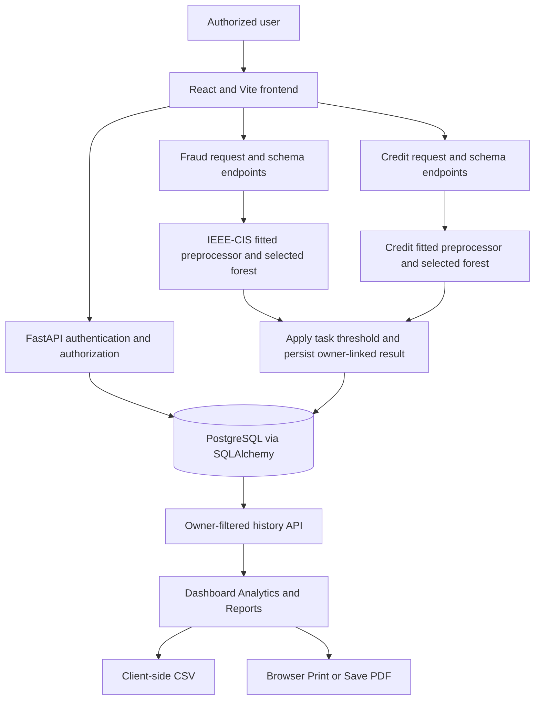

# FraudShield Research Study Documentation

## Document status and evidential basis

**Consolidated academic study document — 18 November 2026.** This document combines the actual application implementation, preserved research evidence, manuscript v1 and the subsequent academic revision assessment. It is intended as a study reference for an undergraduate engineering research paper. It is not a claim of independent experimental replication or a submission-ready paper.

The evidence baseline is the preservation package at `C:/Users/Arpit Srivastava/FraudShield-Backups/2026-11-18_205620_IST`. Its inventory records source paths, sizes and SHA-256 hashes. Project paths below are relative to `C:/Users/Arpit Srivastava/PycharmProjects/Fraud-Shield` unless a preserved-package path is specified. Evidence identifiers [E01]–[E22] resolve to actual source files in Section 11; publication identifiers [R1]–[R13] resolve to verified publications or official source pages in Section 12.

Three evidence levels must remain distinct. **Implemented** means that functionality is present in inspected source. **Saved experimental evidence** means that results exist in preserved CSV/JSON/model artifacts. **Previously documented verification** refers to earlier checks described by the audit report. None implies a new live check or an independently reproduced experiment. The present documentation task read files and software-version metadata; it did not fit models, execute evaluation scripts, change metrics, operate the database, submit application records or capture screenshots. Original manuscript v1, application files and frozen research artifacts remain unchanged.

## 1. Implementation of the Proposed System

### 1.1 System architecture

FraudShield is a layered educational application that exposes two independent supervised prediction services through a shared interface. Its frontend presents user authentication, prediction forms, persisted history and reporting. The FastAPI backend validates requests, authorizes users, loads fitted pipelines and records successful predictions through SQLAlchemy. PostgreSQL is the configured deployment database; isolated SQLite fixtures are also used in recorded tests. These roles must not be conflated. A SQLite TestClient demonstration does not establish PostgreSQL or browser behavior. [E01–E06, E11]

**Figure 1. Implemented FraudShield architecture.** The diagram is a source-derived schematic, not a screenshot or experimental result. It explicitly retains separate fraud and credit pipelines. Suggested placement: system implementation section, immediately after the architecture description. There is no fused scoring component in the inspected implementation. [E01–E06]

### 1.2 Frontend layer

The React application provides a landing page, login/registration interface, email-verification and password-recovery views, and an authenticated dashboard. The active dashboard renders a shared prediction component for the two tasks. Fraud input is a JSON editor accepting a complete record with the model's 431 required keys; it is not a grid of 431 individual controls. Credit input is a schema-driven form with ten numerical inputs. The result panel displays the predicted class, a percentage derived from the model score, a display risk band and the saved history ID. [E01, E02]

Dashboard totals and history are obtained from the authenticated history API. The frontend loads history in pages and deduplicates records by ID. Analytics summarizes records by model, predicted class and display risk. Reports provides Both models, Fraud and Credit filters, CSV export and a browser print action. These are client-side summaries of persisted predictions, not live model-quality measurements. Their accuracy in a running browser remains to be reconciled with actual persisted rows. [E02, E03]

Settings contains profile-image and account-provider functionality alongside local presentation preferences and notification controls. The Files entry explicitly reports that file management is unavailable. The Unified Risk view uses the same history-summary component as Analytics; it does not invoke a third model or compute a validated combined risk score. Older page-component filenames in the repository are not by themselves evidence of active page wiring. [E01, E02]

### 1.3 Backend layer and API

The backend is implemented with FastAPI. The inference routes accept a `features` object, require authentication and compare supplied keys against the fitted pipeline schema. Numeric validation rejects inappropriate Boolean and non-finite values. Missing observations are represented as null at the API boundary and converted to missing numeric values before preprocessing. Missing or extra features are rejected rather than silently discarded. Model availability and history-save failures have separate error paths. [E04]

| API area | Implemented endpoints | Purpose |
|---|---|---|
| Availability | `GET /`, `GET /health` | API identity and model-load availability; not database or prediction-quality certification |
| Model schemas | `GET /predict/{model_name}/schema` | Feature names for `fraud` or `credit-risk` |
| Inference | `POST /predict/fraud`, `POST /predict/credit-risk` | Task-specific scoring and successful-history persistence |
| History | `GET /history`, `GET /history/{history_id}` | Owner-filtered list, pagination/filtering and individual record access |
| Registration | `POST /auth/register`, `POST /auth/google/register` | Password and Google registration pathways |
| Sign-in and account linking | `POST /auth/login`, `POST /auth/google`, `POST /auth/google/link`, `GET /auth/me` | Authentication and current-account access |
| Verification | `GET /auth/verify-email`, `POST /auth/resend-verification` | Email verification pathways |
| Session lifecycle | `POST /auth/refresh`, `POST /auth/logout` | Refresh and revocation handling |
| Account recovery | `POST /auth/forgot-password`, `POST /auth/reset-password` | Password-recovery pathways |
| Profile image | `GET /auth/profile-picture`, `PUT /auth/profile-picture` | Authenticated image retrieval/update |

This endpoint inventory establishes implementation in code, not that every route has been independently exercised in a live browser. [E04, E05]

### 1.4 Independent ML pipelines and inference

The backend loads `fraud_selected.joblib` and `credit_selected.joblib` at startup. Each artifact contains a fitted preprocessor, fitted Random Forest and stored decision threshold. The loader computes an artifact SHA-256, validates the threshold and sets forest `n_jobs=1` for fixed-order score accumulation. It does not train or calibrate a model at startup. [E04, E07]

For fraud, the input is a 431-feature IEEE-CIS transaction record and class 1 denotes fraud. For credit, the input contains ten borrower attributes and class 1 denotes the dataset's serious-delinquency outcome. The service reads the positive-class score, compares it with the task threshold and returns the predicted class. The thresholds are 0.21 for fraud and 0.23 for credit. A score equal to the threshold is classified positive. [E04, E07, E09]

The interface displays the score as a probability, but this study has no calibration experiment. Therefore, the research interpretation is a positive-class model score, not a validated estimate of absolute financial risk. Low/Medium/High display bands use 0.30 and 0.70 cutoffs independently of classification. A fraud-positive result can consequently have a Low display band; the same can occur for credit. This is a consequence of implemented conventions, not contradictory model output. [E04]

### 1.5 Authentication and database layer

The authentication code implements JWT bearer access, scrypt password hashing, hashed refresh tokens, email-verification and reset-token storage, and Google credential verification. The frontend holds the access token in application state and has a refresh-cookie session-restoration path. The database schema separates users, authentication identities, refresh sessions, reset tokens, verification tokens and prediction history. [E01, E05, E06]

New prediction rows receive the authenticated user's ID. History-list and individual-record queries check ownership. History ownership is nullable to accommodate legacy or detached records; unowned rows do not become another user's personal history. Identity/session/token relationships use account foreign keys with deletion cascades, whereas prediction ownership uses `ON DELETE SET NULL`. Stored history includes model type, class, score, display risk and time; it does not persist the model artifact version or decision threshold. [E04, E06]

The application builds its SQLAlchemy engine from `DATABASE_URL` and has no exception-driven SQLite fallback. PostgreSQL schema management uses Alembic; the application's SQLite startup branch is used only when SQLite has been explicitly configured. The previous audit describes PostgreSQL 18.6, an upgrade to revision `9ab32e041a67`, zero detected schema drift and successful disposable-database checks. Those are historical audit outcomes, not checks repeated for this document. [E06, E11]

### 1.6 Implemented versus unverified behavior

| Functionality | Evidence status | Remaining qualification |
|---|---|---|
| Both prediction pipelines | Artifacts, schemas, source and saved replay present | No new inference or full HTTP holdout replay in this task |
| Authentication and ownership filters | Source implementation and prior automated evidence | Actual Google consent, live browser isolation and SMTP delivery remain incomplete |
| PostgreSQL persistence/migrations | Previously documented audit | Database was not queried in this task; downgrade ownership-loss limitation remains |
| Dashboard/Analytics/Reports | Source implemented | Counts, downloads and print output need live reconciliation |
| Individual history access | API implemented | No individual-detail action exists in the inspected table UI |
| CSV and Print/Save PDF | Source implemented | Actual downloaded files and saved PDFs not verified in the browser |
| Unified application | Implemented shared interface/storage | Fused predictive modeling is absent |
| Genuine application screenshots | Pending | No workflow captures are supplied as completed evidence |

## 2. System Requirements and Experimental Setup

### 2.1 Hardware and environment boundaries

No verified historical CPU, GPU, RAM, storage specification, training duration or measured minimum hardware requirement was established. A hardware table with invented processor or memory values would therefore be inappropriate. The code uses scikit-learn forests with CPU parallelism, but that fact is not a benchmark of minimum capacity or proof of historical machine specifications. [E08, E19]

Exact software versions below are separated by provenance. Current installed versions were read from the project virtual environment on 18 November 2026; frontend resolved versions came from the lockfile; PostgreSQL comes from the prior audit. These are not presented as a complete recovered environment for every historical experiment. The README's setup guidance and requirement ranges are instructions, not proof that a particular old run used those versions. [E11, E18, E19]

| Component | Exact observed version | Evidence interpretation |
|---|---|---|
| Python | 3.13.9 | Current inspection interpreter |
| scikit-learn | 1.9.1 | Current installed package; requirements also pin this version |
| pandas / NumPy | 3.1.0 / 2.5.4 | Current installed packages |
| joblib / PyArrow | 1.6.0 / 26.0.1 | Current installed packages |
| FastAPI / Uvicorn | 0.162.0 / 0.54.0 | Current installed packages |
| SQLAlchemy / Alembic | 2.1.6 / 1.20.1 | Current installed packages |
| psycopg / PyJWT | 3.3.6 / 2.15.1 | Current installed packages |
| pytest / httpx | 9.2.0 / 0.28.1 | Current installed test packages |
| Node.js / npm | 24.16.0 / 11.13.0 | Current command versions |
| React / React DOM | 18.3.1 / 18.3.1 | Resolved frontend lockfile |
| Vite / Tailwind CSS | 6.4.5 / 4.3.3 | Resolved frontend lockfile |
| Recharts / Google OAuth React wrapper | 2.15.4 / 0.13.5 | Resolved frontend lockfile |
| PostgreSQL | 18.6 | Previously documented live audit; not queried here |

`Backend/requirements.txt` leaves several packages unpinned and specifies ranges for SQLAlchemy, Alembic and psycopg. `Frontend/package.json` also uses compatible version ranges. Consequently, these project files alone do not fully reconstruct the historical environment. A dependency lock or contemporaneous run manifest remains a reproducibility gap. The new `system-environment-evidence.json` records the present inspection without changing requirements. [E18, E19]

### 2.2 Dataset details and feature schemas

IEEE-CIS preparation uses the labeled `train_transaction.csv` and `train_identity.csv` files, left-joined by `TransactionID` with one-to-one validation. The merged file has 590,540 rows and 434 columns. The identifier and target are removed from candidate predictors, and the training-constant V107 is excluded, leaving 431 inputs. The fitted preprocessor treats 400 columns as numeric and 31 as categorical. These are implementation groupings rather than universal semantic definitions of the anonymized features. [E07, E08, E13]

Give Me Some Credit uses `cs-training.csv` with 150,000 labeled rows. The identifier `Unnamed: 0` and target `SeriousDlqin2yrs` are removed, leaving ten numerical predictors. The project interprets the target as serious delinquency within two years; exact original XLS wording remains a final documentation check. The competition's unlabeled test CSVs do not supply the formal results reported here. [E08, E13, E16]

| Dataset | Internal evaluation design | Training | Validation | Holdout | Input features |
|---|---|---:|---:|---:|---:|
| IEEE-CIS | Chronological 70/15/15 | 413,378 | 88,581 | 88,581 | 431 |
| Give Me Some Credit | Stratified random 70/15/15, seed 42 | 105,000 | 22,500 | 22,500 | 10 |

**Table 1. Dataset scope and internal partitions.** Counts are saved experimental evidence, cross-referenced to partition metadata/checks. These designs test different generalization conditions. A later same-dataset fraud period is not external validation, and a random credit holdout is not an out-of-time experiment. [E08, E09, E15]

### 2.3 Preprocessing and partition boundaries

The fraud split script sorts by `TransactionDT` and `TransactionID`, then takes row slices at 70% and 85%. Read-only revision checks confirmed that current partition ID sequences match those slices and have strictly separated time ranges: training 86,400–10,437,996; validation 10,438,003–13,151,840; holdout 13,151,880–15,811,131. These are reference-relative offsets, not calendar dates. [E08, E15]

Numeric preprocessing uses training medians. Categorical preprocessing uses most-frequent imputation and ordinal encoding, with unknown categories mapped to -1. Column types and constant-column removal are derived from training data in the original fraud trainer. Its `Pipeline.fit` receives training X/y and validation prediction occurs afterward. [E08]

The research evaluator reuses that original fraud preprocessor and the already-fitted weighted forest. It fits an unweighted clone on the transformed training partition using float32 memory-mapped arrays. The weighted and unweighted artifacts have identical fitted preprocessor object hashes, identical feature order and recorded sample counts of 413,378; classifier parameters differ only in class weight and worker count. However, no historical fit-time source-ID manifest binds the original forest to a particular raw-data hash. Thus, code and artifact checks support intended equivalence without proving exact historical sample identity. [E08, E15]

For credit research, the evaluator first performs a stratified 70/30 split and then splits the held portion equally using seed 42 at each stage. Its cloned preprocessor is fitted on the 105,000-row training partition, and both forest candidates are fitted anew. This differs from the old credit trainer's 80/20 design. The new demonstration manifest reconstructs membership from the preserved source and algorithm, with disjointness, full-ID coverage and matching saved class counts; no older membership manifest exists for direct historical comparison. [E08, E16]

### 2.4 Forest configuration and class weighting

| Configuration | Fraud research | Credit research |
|---|---|---|
| Classifier | RandomForestClassifier | RandomForestClassifier |
| Trees | 100 | 100 |
| Maximum depth | 16 | 16 |
| Minimum samples per leaf | 2 | 2 |
| Criterion / feature sampling | Gini / square root | Gini / square root |
| Bootstrap / random seed | Enabled / 42 | Enabled / 42 |
| Weighting candidates | `balanced_subsample`, None | `balanced_subsample`, None |
| Selected weighting | None | None |
| Fitting distinction | Weighted fit reused; unweighted fit newly trained by the recorded research procedure | Both candidates fitted on research training partition |
| Baseline | Training-prior constant-score classifier | Training-prior constant-score classifier |

**Table 2. Actual model configuration and comparison scope.** This is a weighting comparison within one model family, not a comprehensive hyperparameter or algorithm benchmark. No SMOTE, NearMiss or other class-resampling experiment is claimed. Bootstrap sampling inside Random Forest is not the same as a separate class-balancing resampling experiment. [E07, E08]

### 2.5 Threshold selection and metrics

Each candidate receives a validation threshold sweep from 0.01 through 0.99 in steps of 0.01. The best F1 chooses a candidate's threshold; ties are broken by greater precision and then greater threshold. The forest with higher best validation F1 is selected between weighted and unweighted. The prior baseline has a separately selected threshold but cannot become the selected serving forest. Each validation table contains 297 operating points: 99 for each of three candidates. [E08, E09]

Accuracy is `(TP+TN)/N`; positive-class precision is `TP/(TP+FP)`; recall is `TP/(TP+FN)`; and F1 is the harmonic mean `2PR/(P+R)`. ROC-AUC evaluates ranking across positive and negative cases. The project separately computes trapezoidal PR-AUC as `auc(recall, precision)` and Average Precision using `average_precision_score`. AP weights precision by recall increments and must not be relabeled as the trapezoidal area. Earlier validation JSONs used `pr_auc` to name AP, so legacy field names cannot be substituted into final tables. [E08–E10; R4–R6]

## 3. Experimental Results

### 3.1 Dataset distributions

| Dataset | Partition | Total | Negative | Positive | Positive prevalence |
|---|---|---:|---:|---:|---:|
| IEEE-CIS | Training | 413,378 | 398,840 | 14,538 | 0.035169 |
| IEEE-CIS | Validation | 88,581 | 85,539 | 3,042 | 0.034341 |
| IEEE-CIS | Holdout | 88,581 | 85,498 | 3,083 | 0.034804 |
| Credit | Training | 105,000 | 97,982 | 7,018 | 0.066838 |
| Credit | Validation | 22,500 | 20,996 | 1,504 | 0.066844 |
| Credit | Holdout | 22,500 | 20,996 | 1,504 | 0.066844 |

**Table 3. Saved class distributions, with prevalence rounded to six decimals.** Both tasks are imbalanced, but their positive targets and evaluation partitions remain distinct. [E09]

### 3.2 Selected-model holdout results

| Measure | IEEE-CIS selected unweighted forest | Credit selected unweighted forest |
|---|---:|---:|
| Decision threshold | 0.21 | 0.23 |
| Accuracy | 0.952281 | 0.918711 |
| Precision | 0.343373 | 0.407090 |
| Recall | 0.406747 | 0.473404 |
| F1-score | 0.372383 | 0.437750 |
| ROC-AUC | 0.866884 | 0.857274 |
| Trapezoidal PR-AUC | 0.438250 | 0.395205 |
| Average Precision | 0.438290 | 0.395532 |
| Test samples | 88,581 | 22,500 |
| Actual positive cases | 3,083 | 1,504 |
| Detected positives | 1,254 | 712 |

**Table 4. Saved final internal-holdout performance.** Values are transcribed/rounded from selected CSV rows and agree with the saved replay JSON. They are not freshly calculated experiments. Full-precision originals remain preserved. [E09]

The selected fraud model has strong accuracy relative to its recall: it detects fewer than half of the actual fraud observations. Credit has a similar limitation, detecting 712 of 1,504 positive borrowers. Accuracy therefore cannot be read as the fraction of positive outcomes successfully identified. Neither result establishes an autonomous decision system, calibrated risk or cost-effective deployment.

### 3.3 Weighting, thresholds and baselines

| Dataset | Candidate | Validation threshold | Validation precision | Validation recall | Validation F1 |
|---|---|---:|---:|---:|---:|
| Fraud | Weighted | 0.62 | 0.517678 | 0.389875 | 0.444778 |
| Fraud | Unweighted, selected | 0.21 | 0.622129 | 0.391847 | 0.480839 |
| Fraud | Constant prior | 0.03 | 0.034341 | 1.000000 | 0.066403 |
| Credit | Weighted | 0.54 | 0.363959 | 0.476729 | 0.412781 |
| Credit | Unweighted, selected | 0.23 | 0.416104 | 0.491356 | 0.450610 |
| Credit | Constant prior | 0.06 | 0.066844 | 1.000000 | 0.125312 |

**Table 5. Saved validation operating points.** Model selection uses validation F1; holdout outcomes do not choose the selected candidate. [E09]

| Dataset | Candidate | Holdout accuracy | Precision | Recall | F1 | ROC-AUC | PR-AUC, trapezoidal | AP |
|---|---|---:|---:|---:|---:|---:|---:|---:|
| Fraud | Weighted | 0.964868 | 0.494235 | 0.403179 | 0.444087 | 0.858529 | 0.445893 | 0.445964 |
| Fraud | Unweighted, selected | 0.952281 | 0.343373 | 0.406747 | 0.372383 | 0.866884 | 0.438250 | 0.438290 |
| Fraud | Constant prior | 0.034804 | 0.034804 | 1.000000 | 0.067267 | 0.500000 | 0.517402 | 0.034804 |
| Credit | Weighted | 0.909022 | 0.360411 | 0.466090 | 0.406495 | 0.840805 | 0.341118 | 0.341536 |
| Credit | Unweighted, selected | 0.918711 | 0.407090 | 0.473404 | 0.437750 | 0.857274 | 0.395205 | 0.395532 |
| Credit | Constant prior | 0.066844 | 0.066844 | 1.000000 | 0.125312 | 0.500000 | 0.533422 | 0.066844 |

**Table 6. Saved complete holdout comparison at each candidate's validation-selected threshold.** The constant prior produces no useful discrimination. Its comparatively large trapezoidal area results from the integration of a degenerate constant-score PR curve; its AP equals prevalence. It must not be described as outperforming the forests in useful positive-case ranking. [E08, E09; R5]

### 3.4 Validation-to-holdout analysis

The IEEE-CIS unweighted forest wins validation F1, 0.480839 versus 0.444778, but the weighted forest wins holdout F1, 0.444087 versus 0.372383. The selected unweighted model's validation precision of 0.622129 decreases to 0.343373 on holdout. This is a real finding in the saved results and must remain visible. A higher validation score did not guarantee a higher later-period score. It would be methodologically inappropriate to conceal the selected model's result or retrospectively declare a new selection using the holdout. [E09]

The record does not establish why this reversal occurred. Distribution shift, sampling variation and other factors remain possible questions, not proven causes. A chronological design supplies a relevant setting in which deterioration can be observed, but no drift statistic, causal test or adaptive experiment was performed. [E15; R3]

For credit, the unweighted candidate has both higher validation F1 and higher holdout F1 than the weighted comparator. This supports a descriptive result for the saved random split. A single-seed comparison without confidence intervals does not establish general superiority of unweighted forests, and cross-dataset differences cannot be attributed to weighting alone. [E09]

## 4. Confusion Matrices and Error Interpretation

Rows below denote the actual class and columns the predicted class. Class 0 is legitimate/no serious delinquency, and class 1 is fraud/serious delinquency respectively. These are dataset labels and predictions, not recorded institutional interventions. [E09]

### 4.1 IEEE-CIS selected model

| Actual class | Predicted legitimate | Predicted fraud |
|---|---:|---:|
| Legitimate | TN = 83,100 | FP = 2,398 |
| Fraud | FN = 1,829 | TP = 1,254 |

**Table 7. Fraud confusion matrix at threshold 0.21.** True positives are correctly flagged fraud observations; false positives are legitimate transactions incorrectly flagged; false negatives are fraud observations not flagged; true negatives are legitimate observations classified negative. [E09]

Precision 0.343373 describes the fraction of flagged transactions that carry the fraud label. Recall 0.406747 describes the fraction of actual fraud detected. F1 0.372383 summarizes this operating point but does not encode investigator capacity or financial loss. The 2,398 false alerts could create review burden, while 1,829 missed cases limit detection coverage; the study does not measure actual review time or monetary consequences. [E09]

### 4.2 Give Me Some Credit selected model

| Actual class | Predicted no serious delinquency | Predicted serious delinquency |
|---|---:|---:|
| No serious delinquency | TN = 19,959 | FP = 1,037 |
| Serious delinquency | FN = 792 | TP = 712 |

**Table 8. Credit confusion matrix at threshold 0.23.** A credit false positive is an incorrect positive delinquency classification; it is not evidence that a loan was denied. A false negative is an actual positive outcome classified negative; it is not a measured monetary loss. [E09]

Precision is 0.407090, recall 0.473404 and F1 0.437750. These values indicate that substantial numbers of both incorrect positive labels and missed positive outcomes remain. They support an academic screening comparison, not eligibility decisions, validated lending policy or a claim of fair treatment across borrower groups. No subgroup or intervention study is available.

### 4.3 All-candidate confusion counts

| Dataset | Candidate | TN | FP | FN | TP |
|---|---|---:|---:|---:|---:|
| Fraud | Weighted | 84,226 | 1,272 | 1,840 | 1,243 |
| Fraud | Unweighted, selected | 83,100 | 2,398 | 1,829 | 1,254 |
| Fraud | Prior | 0 | 85,498 | 0 | 3,083 |
| Credit | Weighted | 19,752 | 1,244 | 803 | 701 |
| Credit | Unweighted, selected | 19,959 | 1,037 | 792 | 712 |
| Credit | Prior | 0 | 20,996 | 0 | 1,504 |

**Table 9. Saved confusion counts across candidates.** The baseline predicts every observation positive at its selected threshold. Its recall of one is obtained with a large false-alert burden, not a useful operating advantage in isolation. [E09]

## 5. Research Tables and Feature Importance

Tables 1–9 provide dataset scope/distribution, model configuration, validation thresholds, final metrics, candidate comparison and confusion counts. The following table adds global feature importance. All coefficients are saved mean-decrease-in-impurity values, rounded to six decimals; they are not regression effects, calibrated risks or causal coefficients. [E10]

| Rank | Fraud feature | Impurity importance | Credit feature | Impurity importance |
|---|---|---:|---|---:|
| 1 | V257 | 0.027260 | RevolvingUtilizationOfUnsecuredLines | 0.190604 |
| 2 | V246 | 0.024275 | NumberOfTimes90DaysLate | 0.178482 |
| 3 | C1 | 0.023659 | DebtRatio | 0.127224 |
| 4 | V258 | 0.021396 | MonthlyIncome | 0.107576 |
| 5 | C13 | 0.019885 | age | 0.100760 |
| 6 | V45 | 0.019036 | NumberOfTime60-89DaysPastDueNotWorse | 0.080873 |
| 7 | V189 | 0.017755 | NumberOfTime30-59DaysPastDueNotWorse | 0.076947 |
| 8 | C7 | 0.017231 | NumberOfOpenCreditLinesAndLoans | 0.075161 |
| 9 | V201 | 0.016633 | NumberOfDependents | 0.032881 |
| 10 | C11 | 0.014936 | NumberRealEstateLoansOrLines | 0.029492 |

**Table 10. Saved leading global impurity rankings.** Fraud has additional ranked variables; the ten-row credit list covers its ten predictors. Rankings describe each fitted forest and should not be compared across datasets as though they used a shared feature space. Their stability across alternative samples was not evaluated. [E10]

## 6. Research Figures and Pictures

### 6.1 Existing experimental plots

All eight experimental images exist and were preserved; earlier read-only checks verified PNG integrity and matching hashes. This document does not redraw or alter them. The figure inventory below uses paths relative to `Backend/reports/research/`. Figures 2–5 are paired presentations of existing images; final caption/axis readability still requires a venue-scale visual review. [E10]

| Figure | Existing source files | Suggested placement and caption |
|---|---|---|
| 2(a), 2(b) | `fraud/confusion_matrix.png`; `credit/confusion_matrix.png` | After Section 4: “Selected-model confusion matrices on the respective internal holdouts at fraud threshold 0.21 and credit threshold 0.23. Actual classes form rows and predictions form columns.” |
| 3(a), 3(b) | `fraud/roc.png`; `credit/roc.png` | After Table 4: “ROC curves of the selected fraud and credit pipelines. Curves evaluate score discrimination; they do not establish probability calibration.” |
| 4(a), 4(b) | `fraud/precision_recall.png`; `credit/precision_recall.png` | After Table 6: “Precision–recall curves on the separate holdouts. AP and trapezoidal PR-AUC are reported distinctly in the results table.” |
| 5(a), 5(b) | `fraud/feature_importance.png`; `credit/feature_importance.png` | After Table 10: “Global fitted-forest impurity rankings. These summaries are not local or causal explanations.” |

The original files can be opened directly: [fraud confusion matrix](</C:/Users/Arpit Srivastava/PycharmProjects/Fraud-Shield/Backend/reports/research/fraud/confusion_matrix.png>), [credit confusion matrix](</C:/Users/Arpit Srivastava/PycharmProjects/Fraud-Shield/Backend/reports/research/credit/confusion_matrix.png>), [fraud ROC](</C:/Users/Arpit Srivastava/PycharmProjects/Fraud-Shield/Backend/reports/research/fraud/roc.png>), [credit ROC](</C:/Users/Arpit Srivastava/PycharmProjects/Fraud-Shield/Backend/reports/research/credit/roc.png>), [fraud PR](</C:/Users/Arpit Srivastava/PycharmProjects/Fraud-Shield/Backend/reports/research/fraud/precision_recall.png>), [credit PR](</C:/Users/Arpit Srivastava/PycharmProjects/Fraud-Shield/Backend/reports/research/credit/precision_recall.png>), [fraud importance](</C:/Users/Arpit Srivastava/PycharmProjects/Fraud-Shield/Backend/reports/research/fraud/feature_importance.png>), [credit importance](</C:/Users/Arpit Srivastava/PycharmProjects/Fraud-Shield/Backend/reports/research/credit/feature_importance.png>).

No dedicated threshold plot or candidate-comparison chart was found; existing tables are adequate for those results. `Performance graph.jpeg`, the root report confusion matrix and `Initial Prototype.mp4` must not be substituted for final research plots or current application verification. [E12]

### 6.2 Genuine application pictures still required

| Proposed picture | Required content | Current evidence status |
|---|---|---|
| Figure 6 Dashboard | Actual saved prediction IDs and totals reconciled to owned records | Pending |
| Figure 7(a–b) Fraud demonstration | Real holdout input and actual result with class, score, risk and history ID | Pending |
| Figure 8(a–b) Credit demonstration | Real ten-field holdout input and actual persisted result | Pending |
| Figure 9 Analytics | Actual counts by model/class/risk matched to persistence checkpoint | Pending |
| Figure 10 History and Reports | Actual records and model filters | Pending |
| Supplementary CSV/PDF pictures | Opened real CSV, print preview and saved/opened PDF | Pending |

Suggested caption prefix: “Application integration demonstration using an identified public holdout record.” A selected true label does not guarantee a matching predicted class. Incorrect outcomes must be retained honestly rather than replaced for visual effect. Publication permissions for actual dataset values and input screenshots require review; public availability does not itself establish unrestricted redistribution. [E16, E17; R13]

The reviewed manifest selects fraud source IDs 3488959 and 3488979, and credit source IDs 12 and 1, by smallest ID within each true class of the appropriate holdout. Targets and identifiers remain metadata and are excluded from payloads. No prediction, live submission or screenshot has been performed for those prepared records. A separate approval gate remains in force. [E16, E17]

## 7. Complete Research and Application Workflow

### 7.1 Acquisition and preparation

The study begins with authorized acquisition of the public competition datasets, preserving source filenames and checksums. IEEE-CIS transaction and identity files are joined by ID and exported as a merged Parquet dataset. The data are sorted and partitioned chronologically before training-related feature decisions. Credit retains the labeled borrower CSV and reconstructs its stratified partitions using the documented two-stage seed-42 procedure. Competition test files remain separate from internal labeled holdouts. [E08, E13]

### 7.2 Training and validation

The original fraud training pipeline derives constants/types and fits preprocessing and a weighted forest on its training partition. The research procedure reuses that pipeline's preprocessing and weighted classifier, then fits the unweighted comparison on transformed training observations. Credit research refits a cloned preprocessor and both candidate forests on the research training partition. Validation data determine thresholds and the selected forest. These are descriptions of saved implementation/procedure, not training performed for this document. [E07, E08, E15]

### 7.3 Holdout testing and serialization

The recorded evaluator applies each candidate's validation-selected operating point to the holdout and saves distributions, thresholds, metrics, feature rankings and plots. The selected fitted pipeline can be serialized with its threshold using the evaluator's export option. Saved replay evidence records matching selected metrics and artifact hashes. No evaluator or exporter was executed during documentation, because those scripts can write research outputs. [E08–E10]

### 7.4 API integration and user prediction

On application startup, the backend loads the selected fraud and credit artifacts. An authorized user chooses the task, obtains the schema and provides feature values through its form. The API authenticates the request, validates the feature set/types, applies fitted preprocessing and scores the observation. It applies the task threshold and independent display risk-band rule. A successful response requires history persistence; the source includes rollback/error handling when a history commit fails. [E01–E07]

### 7.5 Persistence, analytics and reports

The saved record belongs to the authenticated user. Subsequent history requests are ownership-filtered. The frontend refreshes the history after a prediction and aggregates those records for Dashboard, Analytics and Reports. CSV export serializes the filtered rows and Print/Save PDF delegates to the browser. This workflow is implemented, but genuine browser demonstration must verify response-to-row parity, counts, downloaded file contents and print layout. [E02–E06, E17]

The formal research evaluation and application demonstration have different purposes. The former evaluates the full saved holdouts; the latter checks that representative inputs traverse the real UI/API/persistence path. Four illustrative cases are not an independent estimate of precision, recall or accuracy and must never be added to frozen performance tables.

## 8. Final Research Gaps

The gaps below are project-specific limitations informed by literature, not claims that the entire field lacks solutions. Existing financial-ML literature already studies imbalance, calibration, explanations and temporal validation. [R2–R12]

### 8.A Class imbalance

**Literature basis.** Positive-class evaluation and threshold selection depend on both class distribution and the intended operating objective. PR and ROC describe different aspects of discrimination, and F1 tuning is not equivalent to optimizing institutional cost. Recent weighting and calibration studies further show that balancing choices need not uniformly improve classification or reliable risk estimation. These general findings do not prove that a particular correction will help FraudShield. [R4–R8]

**Project limitation and implementation.** Fraud and delinquency are minority outcomes in the saved partitions. The project compares `balanced_subsample` and unweighted forests, selects thresholds using validation F1, and reports precision, recall, F1, ROC-AUC, AP and confusion counts. A constant-prior comparator makes the effect of predicting everything positive visible. No documented SMOTE, undersampling, NearMiss or other class-resampling experiment exists in this research comparison. [E08, E09]

**Supporting experiments and achievement.** The six saved candidate rows, 594 total validation operating points across datasets, and selected confusion matrices provide direct imbalance-aware experimental evidence. Selected forests have higher saved F1 and AP than prior baselines. However, the fraud weighting advantage reverses between validation and holdout, and both tasks miss many positives. These results establish that imbalance was examined, not solved. [E09]

**Incomplete work and status.** There are no cost-sensitive utility estimates, threshold-stability intervals, repeated-seed conclusions, calibrated posterior estimates or external deployment tests. Additional methods would need separate authorization and versioned experiments. **Status: partially addressed.** The measurable comparison objective is completed in saved evidence; robust handling of the broader imbalance problem is not fully achieved.

### 8.B Lack of explainability

**Literature basis.** Financial explainability work distinguishes global feature relevance, local prediction attribution and interpretable model structure. Recent GMSC and IEEE-CIS studies examine explanations or intrinsically interpretable models; these approaches do not make an impurity ranking a local explanation. [R9–R11]

**Project limitation and implementation.** The saved pipeline exports mean-decrease-in-impurity rankings and top-feature plots for both tasks. These identify which variables the fitted forest uses strongly in aggregate. No demonstrated SHAP, local explanation, counterfactual explanation, explanation-stability study or user explanation assessment exists. The active prediction response does not provide a per-case explanation. [E04, E10]

**Supporting evidence and achievement.** Both `importance.csv` files and two existing feature-importance figures support the claim of global model inspection. The leading features in Table 10 are real saved coefficients. This permits a limited discussion of the fitted model; it does not establish causation, clinical/financial meaning for anonymized variables, individual reasons or fair decisions.

**Incomplete work and status.** Local explanations, stability across samples, explanation fidelity and meaningful user presentation remain future work. No new explanation implementation or experiment is implied. **Status: partially addressed at a global descriptive level; full explainable AI is not achieved.**

### 8.C Unified financial-risk structure

**Literature basis.** Fraud detection and borrower delinquency involve different observational units and labels. Broader credit-scoring and fraud literature demonstrates that methods and validation must be matched to the task; it does not supply a validated rule for combining these particular outputs. Recent financial explanation frameworks also contain their own dataset/protocol assumptions and cannot be imported as a joint-risk guarantee. [R2, R3, R9–R11]

**Project limitation and implementation.** FraudShield unifies user access, interface navigation, model availability, owned prediction history, analytics and reports. It retains independent preprocessors, classifiers, thresholds and target interpretations. Its Unified Risk page is a combined display of history summaries. The datasets do not provide a shared aligned transaction–borrower target or a validated combined financial-risk outcome. [E01–E07]

**Supporting evidence and achievement.** Active page wiring, the two inference routes, the `model_type` history field and shared reporting component establish unified application architecture. The research tables evaluate each task separately; none evaluates joint prediction. Application execution evidence remains partially documented rather than fully demonstrated in the browser. [E02–E06, E09, E11]

**Incomplete work and status.** A fused classifier or validated combined risk score would require a justified target, linked data, combination rule and separate evaluation. Averaging two uncalibrated scores with different meanings would not establish such a model. **Status: unified application structure is implemented, with live evidence incomplete; unified predictive modeling is not addressed.**

### 8.D Concept drift as a separate research direction

**Literature basis.** Operational fraud studies discuss evolving distributions and delayed labels. Recent IEEE-CIS work uses out-of-time or temporal protocols, illustrating that time-aware evaluation is distinct from detecting change or adapting a model. [R3, R10, R11]

**Project limitation and implementation.** The fraud study uses a later-period holdout and documents a validation-to-holdout change. There is no implemented drift detector, online update mechanism, change-point alert, adaptive threshold or drift-triggered retraining workflow. Offline training scripts are not an adaptive system merely because they could be rerun. [E04, E08, E15]

**Supporting evidence and achievement.** Chronological split verification and saved performance differences support time-separated evaluation. They do not test a drift hypothesis or show that drift caused the fraud reversal. Credit's random holdout supplies no temporal-drift evidence. [E09, E15]

**Incomplete work and status.** Feature/label shift analysis, monitored calibration/discrimination over time, delayed-label treatment, detector false-alarm control and evaluated adaptation are future directions. **Status: temporal evaluation is present; concept-drift detection and adaptation are not addressed experimentally or operationally.**

| Gap | Implemented/evaluated component | Overall research status |
|---|---|---|
| Class imbalance | Weight comparison, validation thresholds, prior baseline and positive-class metrics | Partially addressed |
| Explainability | Global impurity ranks and plots | Partially addressed; no local XAI |
| Unified structure | Shared application with separate pipelines | Architectural integration implemented; fused modeling not addressed |
| Concept drift | Chronological fraud holdout only | Drift detection/adaptation not addressed |

**Table 11. Gap assessment.** No broad gap is declared fully solved by the present evidence.

## 9. Objectives of the Research Study

### 9.1 Research aim

**To evaluate and document two independent Random Forest pipelines for transaction fraud and serious-delinquency prediction using explicit validation-based selection and preserved holdout evidence, and to assess their integration within an authenticated financial-monitoring application.**

The aim concerns a transparent empirical/application study. It does not promise a new algorithm, a fused score or operationally validated financial decisions.

### 9.2 Measurable objectives and evidence

| Objective | Measurable criterion | Actual supporting evidence | Status |
|---|---|---|---|
| O1 Specify datasets and partitions | Identify input schemas and report row/class counts for all six partitions | Dataset files, split scripts and distributions; read-only chronology/membership checks | Completed for present evidence; release authenticity/terms remain qualified |
| O2 Define task-specific pipelines | Document feature counts, fitted preprocessing, parameters and separate targets | Selected artifacts, original trainers and evaluator | Completed descriptively; historical exact fraud fit-row lineage remains incomplete |
| O3 Compare class weighting | Report weighted/unweighted/prior results and each validation operating point | Two threshold CSVs and two candidate metric CSVs | Completed as saved experiments, not newly reproduced |
| O4 Select operating points without using test metrics in code | Apply the 99-point grid and validation F1/tie rules | Evaluator and saved validation rows | Procedure implemented; historical analyst non-use of holdout cannot be independently certified |
| O5 Assess positive-class errors | Report final metrics and TN/FP/FN/TP for each selected model | Saved holdout tables, replay JSON and plots | Completed as saved evidence |
| O6 Describe global feature relevance | Provide rankings and figures for each fitted selected forest | Two importance CSVs and plots | Completed at global impurity level only |
| O7 Integrate real inference and owned history | Trace form-to-API-to-row behavior and reconcile actual dashboard/report counts | Source, saved TestClient example and previous audit | Partially completed; live browser/CSV/PDF evidence pending |
| O8 Provide per-case explanations | Demonstrate validated local attribution or equivalent explanation | No such implementation/evaluation found | Future objective; not achieved |
| O9 Validate a fused risk score | Define linked target/data, combination and separate evaluation | No fused artifact or joint experiment found | Future objective; not achieved |
| O10 Detect/adapt to drift | Evaluate a detector and adaptation with time-aware controls | No detector/adaptation experiment found | Future objective; not achieved |

**Table 12. Objective-to-evidence mapping.** Objectives O8–O10 are prospective extensions, not retroactive claims of the completed study.

## 10. Final Research Positioning

### 10.1 Research problem and gap

The research problem is to assess minority positive outcomes in two different financial datasets while preserving the distinction between model selection, final evaluation and application operation. The project-specific gap is the need for a transparent, traceable comparison and implementation whose claims do not exceed its evidence. The literature already contains weighting methods, temporal evaluation and explanation frameworks; this study does not claim to originate those ideas. [R1–R12]

### 10.2 Research questions

**RQ1:** Within the saved protocols, how do weighted and unweighted forests compare at validation-selected thresholds? The saved results answer this descriptively, with a fraud reversal and a credit unweighted advantage.

**RQ2:** How do final positive-class errors and ranking measures characterize each selected model? Tables 4 and 7–9 answer using the saved holdouts, without estimating confidence intervals.

**RQ3:** What global input rankings are present in the fitted models? Table 10 and existing importance figures answer at the impurity level, not at local or causal levels.

**RQ4:** Can representative observations traverse the actual authenticated inference, persistence and reporting workflow with consistent counts? Source and earlier checks provide partial support; a bounded genuine live demonstration remains pending.

Questions about calibrated risk, fused prediction and drift adaptation are future research questions rather than findings of the current study.

### 10.3 Contributions and scope

The defensible contributions are a documented two-task comparison with explicit partitions and validation thresholds, a transparent account of the fraud validation-to-holdout reversal, global feature-ranking evidence and an artifact-connected application implementation. The final contribution must distinguish implemented integration from the still-pending browser demonstration. No algorithmic novelty or state-of-the-art superiority is established.

The scope is limited to the two named datasets, one Random Forest family, two weighting configurations, a prior baseline, a fixed research seed and internal holdouts. Research and interface evidence are complementary but not interchangeable. The application is an educational prototype, and no observed lending intervention, fraud-investigator decision or economic outcome is measured.

### 10.4 Limitations and future work

Limitations include incomplete historical fit provenance, no independently repeated training/evaluation, unpinned dependencies, a single research seed, no uncertainty/significance analysis, no broad matched model benchmark, no calibration or risk-band validation, no external or subgroup evaluation, and no demonstrated local explanations or drift adaptation. The current split protocols do not establish entity-disjoint fraud performance or out-of-time credit performance. Stored history also lacks artifact/version attribution, and the previously documented migration downgrade can remove ownership values. These are distinct statistical, reproducibility and operational limitations. [E06, E11, E15, E20]

Future work should first resolve evidential and publication issues: dataset attribution/permissions, fit/run manifests, a venue-appropriate literature synthesis, figure readability, and the approved live workflow. Separately authorized follow-up studies could consider repeated seeds, uncertainty, stronger matched baselines, calibration on appropriate data, local explanation fidelity, external validation and monitored drift. They must retain new versioned evidence and should not repeatedly tune on the already exposed holdout or overwrite existing results.

**Recommended final title:** *FraudShield: Validation-Selected Random Forest Pipelines for Transaction Fraud Detection and Credit Delinquency Assessment.* The title accurately describes separate targets and the actual selection procedure, without implying fused prediction or fully explainable adaptive intelligence.

### 10.5 Publication position

The package supports preparation of an undergraduate empirical/application paper, but not an assertion of submission or acceptance readiness. A suitable venue must be chosen according to its actual scope and contribution requirements. Recent literature, uncertainty limitations, source permissions, genuine screenshots where claimed, author information, declarations and final figure/layout quality need review. No venue is assumed, and no acceptance prediction is made. [E20–E22]

## 11. Evidence Mapping and Source Register

This register maps major claims to actual source material. The preserved package mirrors repository files beneath `repository/` and raw public datasets beneath `public_datasets/`. Original file identities are in the preservation inventory. Review documents supply audit findings; they are not replacements for the numerical/artifact sources they identify.

| ID | Real file/source | Supported claim and qualification |
|---|---|---|
| E01 | `Frontend/src/App.jsx`, `Frontend/src/Dashboard.jsx`, `Frontend/src/components/Sidebar.jsx` | Active routes, dashboard page wiring, session restoration and placeholders |
| E02 | `Frontend/src/pages/PredictionForm.jsx`, `Frontend/src/pages/HistoryReport.jsx`, `Frontend/src/pages/DashboardHome.jsx` | Actual form/result, aggregation and report implementation |
| E03 | `Frontend/src/services/api.js`, `Frontend/src/services/reports.js`, `Frontend/src/components/TransactionTable.jsx` | Pagination, model filtering, CSV columns and history rendering |
| E04 | `Backend/app/main.py` | Model loading, endpoints, schema validation, classification/display thresholds and prediction save path |
| E05 | `Backend/app/auth.py`, `Backend/app/security.py`, `Backend/app/email_service.py` | Authentication, hashing, token and mail pathways; delivery/consent not inferred from source |
| E06 | `Backend/app/database.py`, `Backend/app/database_models.py`, `Backend/alembic/versions/*.py` | Database engine configuration, relations/history schema and migrations |
| E07 | `Backend/app/models/fraud_selected.joblib`, `credit_selected.joblib`, `ieee_cis_model.joblib`, `credit_risk_model.joblib` | Selected and original fitted model configurations; original artifact continuity assessed separately |
| E08 | `Backend/training/prepare_fraud_dataset.py`, `create_temporal_splits.py`, `train_ieee_cis.py`, `train_credit_risk.py`, `evaluate_research.py` | Intended preparation/fitting/selection procedures; not executed for this document |
| E09 | `Backend/reports/research/fraud/{distribution.csv,validation_thresholds.csv,test_metrics.csv}`, corresponding `credit/` files, `serving_holdout.json` | All reported distributions, thresholds, validation/holdout metrics and confusion counts |
| E10 | Both research folders' `importance.csv`, `confusion_matrix.png`, `roc.png`, `precision_recall.png`, `feature_importance.png` | Feature coefficients and all eight original experimental figures |
| E11 | `Backend/reports/research/api_workflow.json`, `Final-audit.md`, `Backend/tests/test_api.py`, `Backend/tests/test_migrations.py` | Saved temporary-SQLite workflow, previous 32-backend/2-frontend test and PostgreSQL/build audit claims; not rerun here |
| E12 | `Backend/reports/ieee_cis_metrics.json`, `credit_risk_metrics.json`, `metrics.json`; root `Performance graph.jpeg`, `Initial Prototype.mp4` | Legacy/prototype evidence, excluded from final holdout claims |
| E13 | `Backend/data/processed/{ieee_cis_train_merged,train,validation,holdout}.parquet`; preserved raw CSVs under `public_datasets/IEEE-CIS/` and `public_datasets/GiveMeSomeCredit/` | Actual dataset availability and internal partition source; official release equality not independently certified |
| E14 | Preservation `preservation/inventory.json`, `summary.json`, `exception-review.json` | File hashes, backup verification and reviewed public-contact false positive |
| E15 | `research-paper/revision-review-2026-11-18/methodology-provenance.md` | Read-only ID/time split checks, V107 constancy, stored sample counts, matching fitted preprocessing and Git artifact comparison |
| E16 | `research-paper/2026-11-18-v1/demo-selection-manifest.json`, `prepare_demo_manifest.py`, four `demo-*.json` files | Deterministic holdout examples, source/artifact/payload hashes and no submitted predictions |
| E17 | `research-paper/2026-11-18-v1/demo-execution-plan.md`, `tables-and-figures.md` | Pending genuine browser/persistence/CSV/PDF evidence and figure plan |
| E18 | `Backend/requirements.txt`, `Frontend/package.json`, `Frontend/package-lock.json`, `README.md` | Declared requirements, resolved frontend versions and setup guidance; not historical run certification |
| E19 | `research-paper/revision-review-2026-11-18/system-environment-evidence.json` | Current exact installed/lockfile versions, inspection date and lack of verified historical hardware |
| E20 | `research-paper/2026-11-18-v1/verification-register.md`; revision-review `review-report.md`, `v2-change-plan.md` | Outstanding limitations, methodological assessment and publication-readiness gaps |
| E21 | `research-paper/2026-11-18-v1/manuscript.md`, `evidence-map.md`, `literature-review.md`, `references.bib` | Existing manuscript narrative and foundational bibliographic verification; originals retained |
| E22 | `research-paper/revision-review-2026-11-18/expanded-literature-matrix.md` | Additional verified 2023–2026 publications, publication/preprint classification and comparability caveats |

### 11.1 Missing-evidence register

| Claim/evidence item | What is missing | Effect on study |
|---|---|---|
| Hardware specifications/minimums | Historical machine record and measured capacity requirements | No hardware claim |
| Exact historical weighted fit lineage | Bound source hashes, IDs/labels and fit log | Equivalence supported but not historically proven |
| Independent reproduction | New authorized independent run | Saved-result interpretation retained |
| Credit original split identity | Historical stored membership manifest | Current reconstruction cannot prove historical identity directly |
| Original credit target wording | Parsed/read-only XLS dictionary confirmation | Project interpretation retained with qualification |
| Calibration and validated risk bands | Dedicated appropriate-data analyses | Scores/bands not validated risks |
| Uncertainty/general superiority | Repeated-seed/CIs/significance or matched broader benchmark | Descriptive comparisons only |
| Local explanation/fairness | Per-case method, fidelity/stability and subgroup study | No full-XAI/fairness claim |
| Fused risk prediction | Aligned target/data and joint model evaluation | Architectural unification only |
| Drift detection/adaptation | Detector and controlled adaptation experiment | Future direction only |
| Live application evidence | Authorized actual submissions, reconciled rows and genuine captures | Figures 6–10 pending |
| Publication permissions | Dataset-specific review of sharing/attribution | Do not assume raw payloads/screenshots are publishable |

## 12. Verified Literature and Interpretation Boundaries

[R1] L. Breiman, “Random Forests,” *Machine Learning*, vol. 45, pp. 5–32, 2001. [DOI 10.1023/A:1010933404324](https://doi.org/10.1023/A:1010933404324). Foundation for randomized tree ensembles; it does not make the present use of forests algorithmically novel.

[R2] S. Lessmann, B. Baesens, H.-V. Seow and L. C. Thomas, “Benchmarking state-of-the-art classification algorithms for credit scoring: An update of research,” *European Journal of Operational Research*, 247(1), 124–136, 2015. [DOI 10.1016/j.ejor.2015.05.030](https://doi.org/10.1016/j.ejor.2015.05.030). Provides credit-scoring benchmark context, not a matched numerical comparison with this study.

[R3] A. Dal Pozzolo, G. Boracchi, O. Caelen, C. Alippi and G. Bontempi, “Credit Card Fraud Detection: A Realistic Modeling and a Novel Learning Strategy,” *IEEE TNNLS*, 29(8), 3784–3797, 2018, online 2017. [DOI 10.1109/TNNLS.2017.2736643](https://doi.org/10.1109/TNNLS.2017.2736643). Supports discussion of operational temporal change and delayed labels, not a causal drift finding for FraudShield.

[R4] T. Saito and M. Rehmsmeier, “The Precision-Recall Plot Is More Informative than the ROC Plot When Evaluating Binary Classifiers on Imbalanced Datasets,” *PLOS ONE*, 10(3), e0118432, 2015. [DOI 10.1371/journal.pone.0118432](https://doi.org/10.1371/journal.pone.0118432). Supports positive-class interpretation; ROC-AUC is still reported rather than declared universally invalid.

[R5] J. Davis and M. Goadrich, “The Relationship Between Precision-Recall and ROC Curves,” *ICML*, 233–240, 2006. [DOI 10.1145/1143844.1143874](https://doi.org/10.1145/1143844.1143874). Relevant to interpolation distinctions and careful use of PR area.

[R6] Z. C. Lipton, C. Elkan and B. Narayanaswamy, “Thresholding Classifiers to Maximize F1 Score,” [arXiv:1402.1892v2](https://arxiv.org/abs/1402.1892v2), 2014. Explicitly cited as a preprint. Its calibrated-score special case is not assumed for FraudShield.

[R7] M. Lukashevich and S. Bairak, “Weighting Strategies for Tabular and Image Data Classification,” *IET Image Processing*, 20(1), e70365, 2026. [DOI 10.1049/ipr2.70365](https://doi.org/10.1049/ipr2.70365). A published weighting study; its findings motivate comparison rather than prove a cause of the local selection reversal.

[R8] A. Carriero, K. Luijken, A. de Hond, K. G. M. Moons, B. van Calster and M. van Smeden, “The Harms of Class Imbalance Corrections for Machine Learning Based Prediction Models: A Simulation Study,” *Statistics in Medicine*, 44(3–4), e10320, 2025. [DOI 10.1002/sim.10320](https://doi.org/10.1002/sim.10320). Its clinical/simulation setting motivates separating calibration from discrimination; it does not prove FraudShield is miscalibrated.

[R9] S. Han and H. Jung, “NATE: Non-pArameTric approach for Explainable credit scoring on imbalanced class,” *PLOS ONE*, 19(12), e0316454, 2024. [DOI 10.1371/journal.pone.0316454](https://doi.org/10.1371/journal.pone.0316454). GMSC explanation/imbalance work using cross-validation, not an identical holdout experiment.

[R10] J. Kang and K. Kim, “Deployment-Oriented Interpretable Fraud Detection via Hybrid Explainable Boosting Machines with Concept–Raw Fusion on the IEEE-CIS Benchmark,” *Applied Sciences*, 16(12), 5809, 2026. [DOI 10.3390/app16125809](https://doi.org/10.3390/app16125809). Relevant to interpretability and out-of-time/entity-separation distinctions; its reported claims are not independently replicated here.

[R11] K. Soylu, B. E. Soylu and M. S. Güzel, “An Explainable Hybrid Learning Framework for Cost-Sensitive Credit-Risk Modeling,” *Electronics*, 15(20), 4622, 2026. [DOI 10.3390/electronics15204622](https://doi.org/10.3390/electronics15204622). Uses a different credit protocol and threshold objective; no direct performance ranking against FraudShield follows.

[R12] F. Lin, Y. Dai and Y. Liu, “On Probability Estimation for Unbalanced Classification,” *Journal of Statistical Theory and Practice*, 20, article 57, 2026. [DOI 10.1007/s42519-026-00572-5](https://doi.org/10.1007/s42519-026-00572-5). Supports distinguishing balancing and posterior estimation; no correction is applied in this study.

[R13] Official Kaggle [IEEE-CIS data page](https://www.kaggle.com/competitions/ieee-fraud-detection/data), [IEEE-CIS rules](https://www.kaggle.com/c/ieee-fraud-detection/rules), and [Give Me Some Credit data page](https://www.kaggle.com/competitions/GiveMeSomeCredit/data). The retrieved IEEE-CIS rules distinguish academic use and onward data sharing. Credit-specific sharing conditions and exact attribution remain unresolved; another competition's rules must not be substituted.

The expanded literature matrix also contains calibration-method background and explicitly labeled newer preprints. Academic metadata verification does not certify those papers' experiments or establish comprehensive literature coverage. This consolidated study uses the verified sources conservatively and does not import external scores into its research tables.
